# Sunset Beach / Ocean Walk

A 296 m sandy shoreline extends the south side of the city. The western beach is
open and informal, with a volleyball court, pastel lifeguard huts, colourful beach
setups and sand castles. Heading east, the shore narrows into a tiled, palm-lined
promenade between two 12/16-storey luxury condos and the 14-storey Pacific Palm
Hotel. The condos extend across the former side sections of Ocean Walk, while
their podiums occupy the sand toward the surf;
rooftop pools, penthouses and private frontage make the beach appropriation visible.
Public access survives in the gaps between buildings. Surf rentals, cafés, palms,
benches and strolling pedestrians occupy the public promenade.
The existing south street provides access and fare pickup/drop-off points.

## Luxury condos

The Sandpiper and Ocean Sunset Suites plots now hold Azure Residences and Ocean
Crest Condos. Both use Lorenzo's supplied straight-overhead transparent condo
PNG, cropped at render time without altering the original file. Each has a
28 × 26 m physical footprint—four times the previous area—on dry sand and the
former side sections of Ocean Walk. The public walkway remains between the two
condos. The original hotel IDs stay stable in
the versioned map, and Pacific Palm Hotel keeps its name and fare stop. An
optional `style` field on beachfront building placements selects the sprite,
so older map documents still load and names do not control appearance. Failed
image decoding falls back to procedural beachfront architecture with resident
signage. The condo sprites omit the renderer's displaced ground shadow while
retaining their footprint-based night-light occluder.

Offline production QA checked desktop and portrait rendering, image failure,
console errors, overflow and external requests. The full package suite, strict
TypeScript production build and map validator passed.

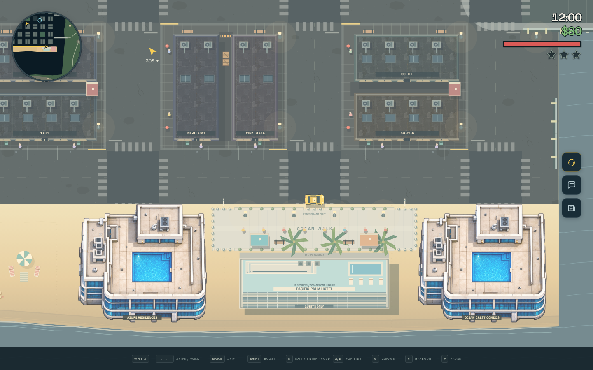
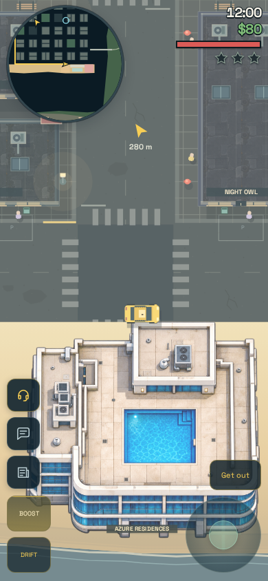

## Seafront spacing

The opposite woodland shore and its seven southern villas, Fairway Country Club,
gardens, pools and road loop have moved **120 m south**. The inlet now gives the
beach a broad open-water outlook, with at least **110 m of unobstructed sea**
across the whole beachfront. The map extends to y = 550 m to accommodate the move.
The southern estate layout is translated at its original scale; the two eastern
approach roads extend smoothly to the relocated loop.

`SOUTH_COAST_OFFSET` / `southPoint()` in `src/countryside.ts` share the translation
between land geometry, navigation, golf holes/cart routes and decorative ridges.
Villa drives, pool collisions, residents, fare stops and the radar derive from
the relocated descriptors. The woodland LAB fixture uses the same live stops:
Woodland Estates is at **(242, 450)** and Fairway Club at **(132, 458)**.

Spacing verification: **410 tests / 29 files** and the production build pass.
The inlet is sampled for both water and stray scenery; full-body road probes
verify dry, clear lanes. Existing integration tests cover southern traffic,
driveway clearance, carts, pools, fares and beach/harbour routes. Offline standalone
browser QA verifies beach and golf rendering, a physical southern road drive at
100 HP, a paid delivery at the relocated club, surf drowning, and a 390 × 844
mobile viewport with no overflow or console errors.

### Before / after overview

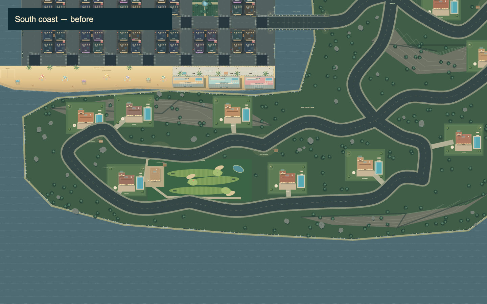
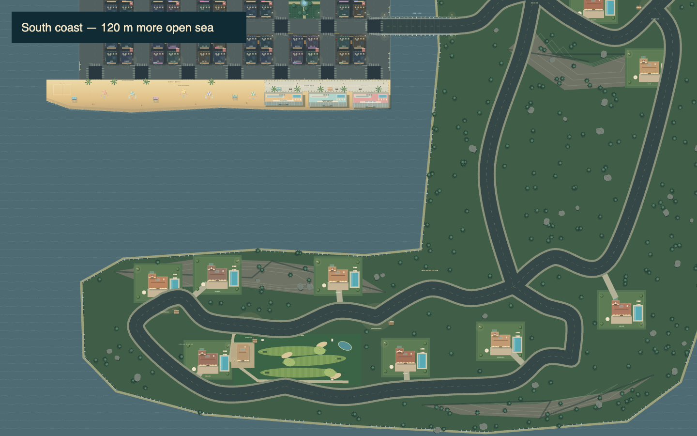
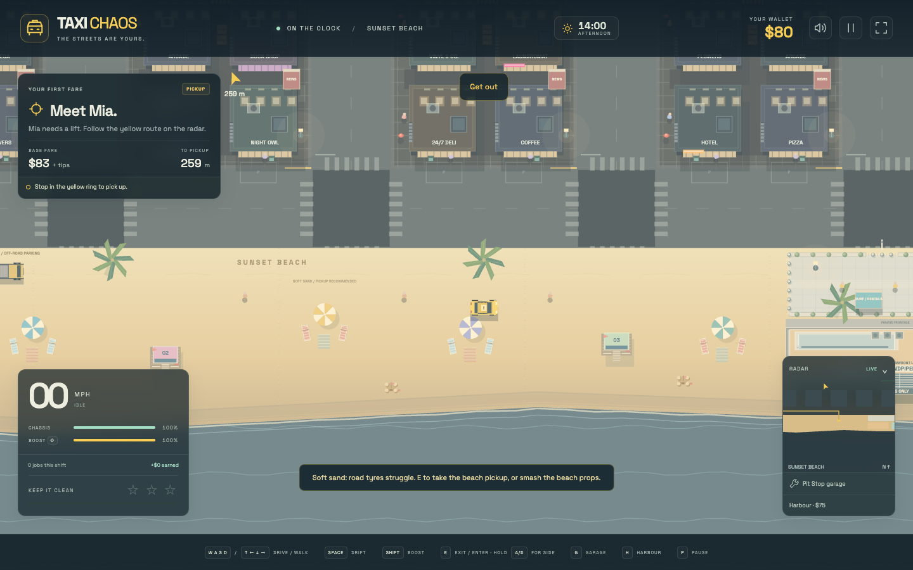
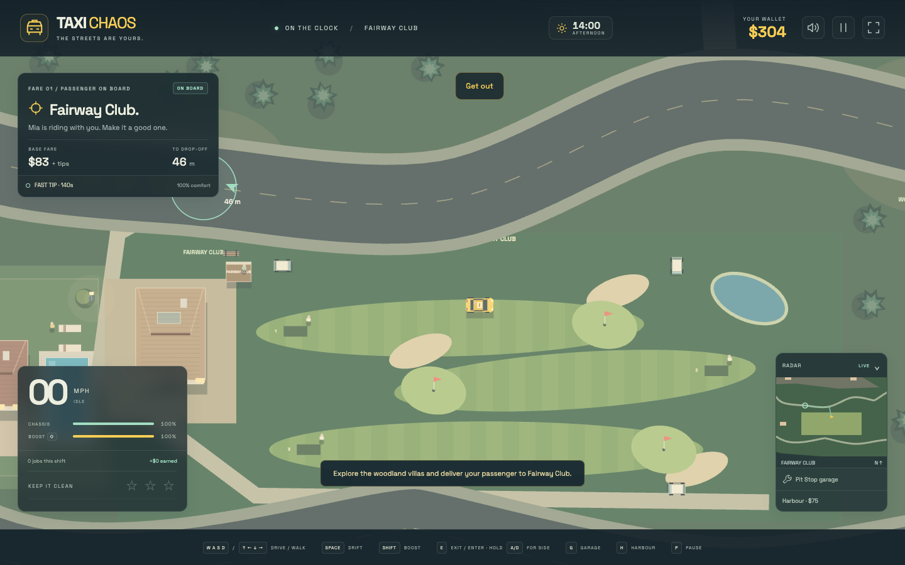
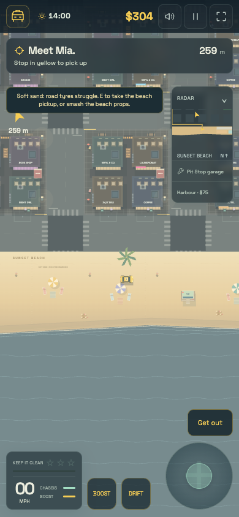

## Aesthetic research before implementation

- [Los Angeles County: Venice Beach](https://beaches.lacounty.gov/venice-beach/): the long shoreline, Ocean Front Walk, volleyball, vendors and beach activity informed the overall layout and informal western court.
- [City of Los Angeles: Venice Beach Recreation Center / Ocean Front Walk](https://recreation.parks.lacity.gov/reccenter/venice-beach): the mix of walking, skating, recreation and beach sports informed the active promenade.
- [Venice Beach photograph / pastel lifeguard tower](https://www.getyourguide.com/venice-beach-l3919/): wide warm sand and the pale-blue raised hut informed the numbered pastel towers, wooden decks/ramps and rescue floats.
- [Venice Beach boardwalk photographs](https://www.hotels.com/go/usa/venice-beach-boardwalk-los-angeles): palm clusters, concrete walking paths, bright beach frontage and golden sand informed the transition to Ocean Walk.
- [Venice Beach Hotels](https://www.venicebeachhotels.com/) and [Venice on the Beach Hotel](https://www.veniceonthebeachhotel.com/): beachfront boutique hotels and roof terraces informed the pastel facades, balconies, sun decks and rooftop pools.

All game art is original procedural Canvas drawing. References supplied visual
inspiration; no third-party photographs, textures or runtime downloads were added.
The new beach fits the game's existing coastal inlet below the city rather than
attempting a geographically exact Los Angeles map.

## Gameplay

- **Destruction:** three lifeguard towers, five striped parasols, ten deck chairs,
  four sand castles and nine palms have physical colliders and finite HP. Impacts
  smash them, slow the vehicle, and use the existing property damage/combo/police
  rules. Wreckage remains visible while dead colliders clear. Towers leave tilted
  roofs and broken ramps; castles flatten into sand. Gentle bumps leave towers intact.
- **Sand:** each tyre samples the shared beach polygon. Ordinary road cars lose
  drive/braking force, lateral grip and cornering traction while increased rolling
  resistance makes them bog down. Mixed road/sand footprints blend by tyre coverage.
  Motorcycles also lose sand traction. No random steering inputs are injected.
- **Pickup:** a parked beach patrol pickup at **(28, 249.5)** can be taken with the
  ordinary **E / Get in** action. It uses a 1,750 kg, 5.2 × 2.15 m body, 14,500 N
  engine, its own wheelbase and off-road sand aptitude. Wallet, upgrades, fares and
  pursuit rules work normally; it can also use the paid harbour exchange.
- **Measured acceleration:** from rest with stock tuning and full throttle, the cab
  reaches **3.66 m/s** after 3 seconds on sand; the pickup reaches **13.35 m/s**.
  Off-road tyres improve handling but do not protect against the water.
- **Promenade:** permanent edging and visible bollard groups physically keep cars,
  pickups and road bikes outside the walking path. The 0.75 m clear openings admit
  the 0.7 m walking body. Vehicle collision envelopes cover each bollard group;
  walkers and civilians resolve individual posts so they can pass through.
- **Sand marks / HUD:** tyres emit ruts after moving 0.65 m and merge straight
  tracks up to 4 m. Leaving sand, teleporting or changing vehicles breaks the
  track. Visible tracks are batched by material/fade into at most 12 canvas
  strokes. Sand handling stays in the secondary gear status; mobile fare cues
  retain priority.
- **Water:** the drawn coast and drowning checks use the same footprint. Driving
  into the surf still splashes/sinks the vehicle and leads to Wasted/hospital recovery.
- **Fares/navigation:** Sunset Beach, Ocean Walk and Pacific Palm Hotel stops sit on
  the south city street. Beach access paths stay on dry land; eastern sand traffic
  stops at the city street rather than a fictional vehicle bypass through the
  narrow private frontage. Walking navigation uses real pedestrian entrances and
  gaps between the building podiums; collider sweeps verify both approaches.

## Implementation and extension

- `src/beach.ts` owns beach/shore geometry, sand detection, access paths, hotel/prop
  descriptors, pedestrian entries and per-tyre `sandHandling()` force modifiers.
- `src/world.ts` creates the actual props, beachfront buildings, barriers, parked pickup and seeded
  beachgoers. `blocksWalking()` distinguishes grouped vehicle entrance envelopes
  from individual pedestrian collision posts. Building footprints live on the beach
  side of Ocean Walk, with widths/heights/floor counts in the shared descriptors.
  The original city blocks are restored, and street lanes remain accessible.
- `src/beach-renderer.ts` draws sand texture, wet shoreline, foam, court/towels,
  tiled walk, the remaining pastel hotel, towers, parasols, chairs, castles, palms and wreckage.
  The two condos use the supplied embedded PNG through the shared artwork renderer,
  with procedural beachfront drawing if it cannot load.
  The local radar also includes sand, promenade and hotels.
- `src/vehicles.ts` adds `terrain.sand` (0 = road, 1 = off-road) to every definition
  and introduces the player-drivable `pickup` model. Existing freight access is unchanged.
- `CarDynamics.surface` applies terrain forces without overwriting base tuning or
  upgrades. `MotorcycleDynamics` applies equivalent traction/drag modifiers. AI
  recovery previews sample the same surface at each predicted pose.
- LAB fixtures: `__taxi.scenario('beach')`, `__taxi.scenario('beach-pickup')` and
  `__taxi.scenario('promenade')`. Snapshots expose `surface` and `sandCoverage`.

## Validation

`npm test -- --maxWorkers=2 --testTimeout=20000` passes **409 tests / 29 files**,
and `npm run build` passes after incorporating the latest moving-exit and motorcycle-crash features. Beach integration checks cover
shore/sea boundaries, clear parked/hotel geometry, dry city/woods routing, all
requested destruction classes, gentle tower impacts, sand acceleration/lateral
traction, mixed tyre coverage, road/upgrades restoration, motorcycle sand forces,
merged sand ruts, drowning/recovery, boosted vehicle exclusion, pedestrian entry from both
sides, pickup entry, harbour eligibility, beach fares and all new LAB fixtures.

`tools/beach-check.cjs` runs production-browser QA with Playwright. It checks the
self-contained build after an offline reload, measures sand acceleration, physically
walks around the abandoned cab and takes the pickup, checks its moving door/jump/landing, rams all four prop classes,
walks the promenade, confirms vehicle exclusion/surf death, and captures day/night
plus 390 × 844, 320 × 568 and 844 × 390 mobile scenes. No page errors or horizontal
overflow were observed. A 60-second mobile sand run plus 120 sampled renders
used at most four sand-track canvas strokes per frame (about 12 ms per sampled
frame in this environment; this is not a device-independent FPS guarantee).
Mobile pickup and delivery instructions remain visible on sand for both cab and
pickup. Unit checks bound the sustained rut queue below 650 segments and sweep
full vehicle/walking bodies against permanent colliders near the eastern edge.

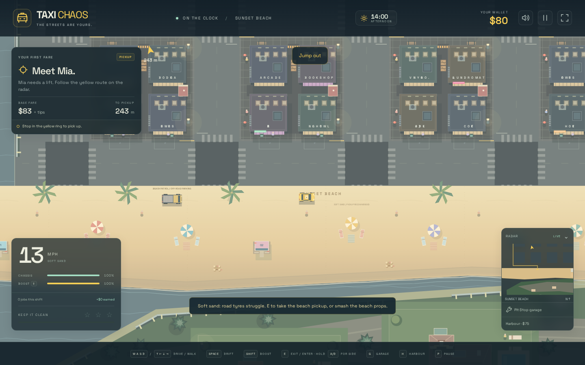
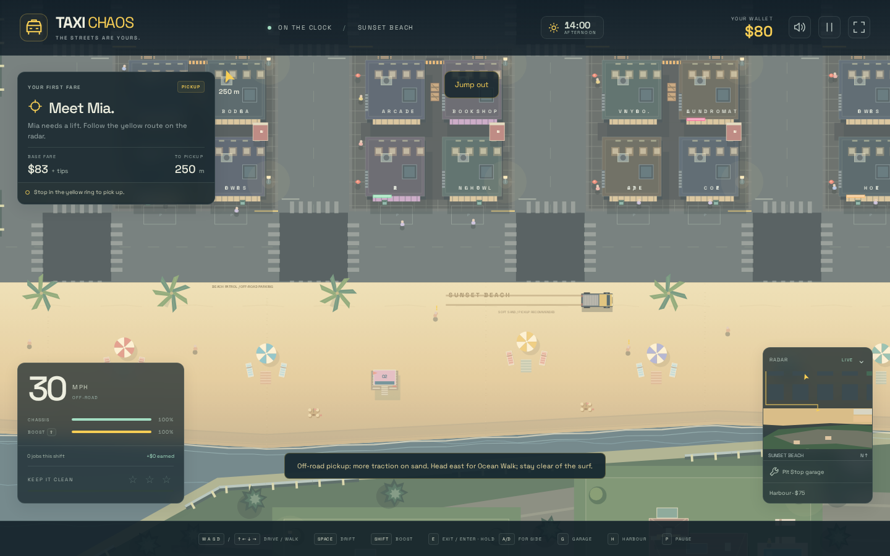
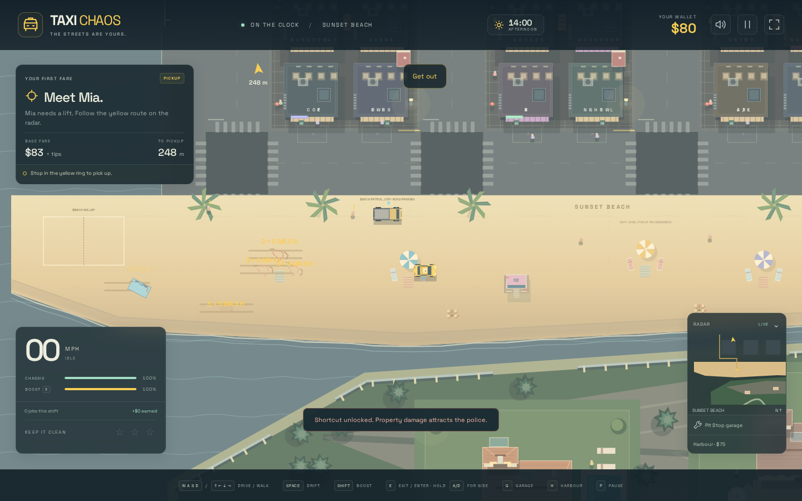
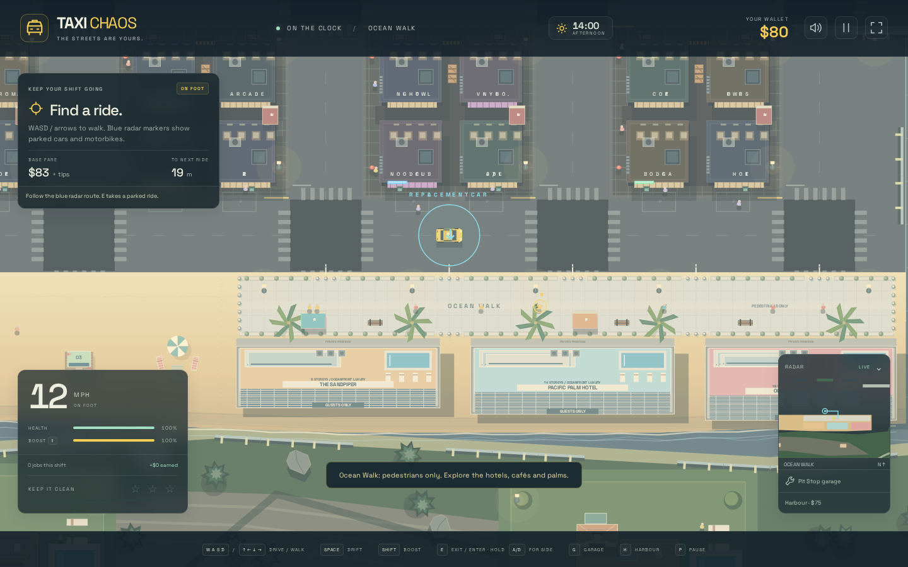
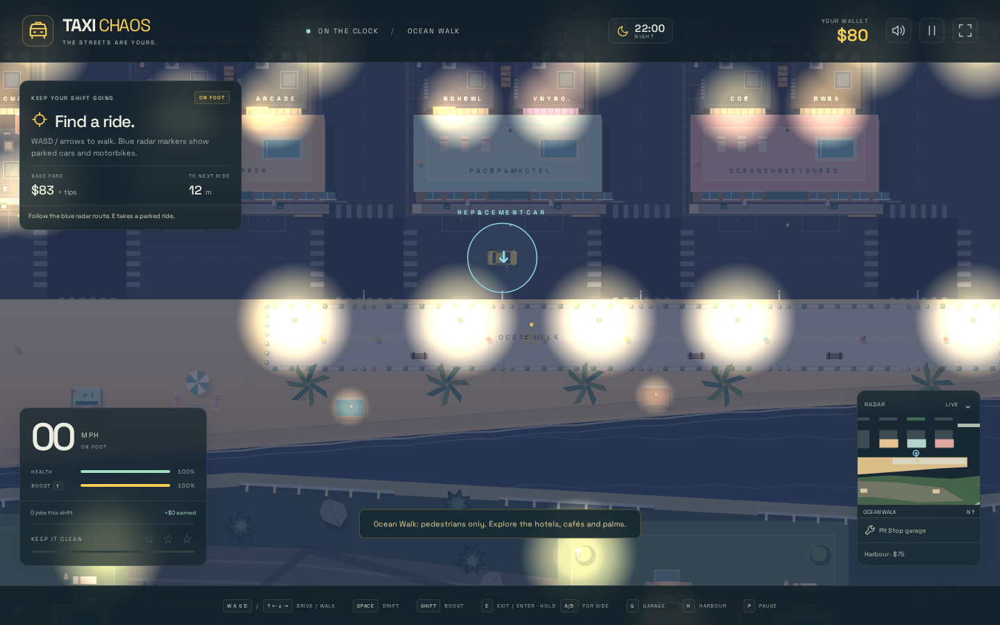
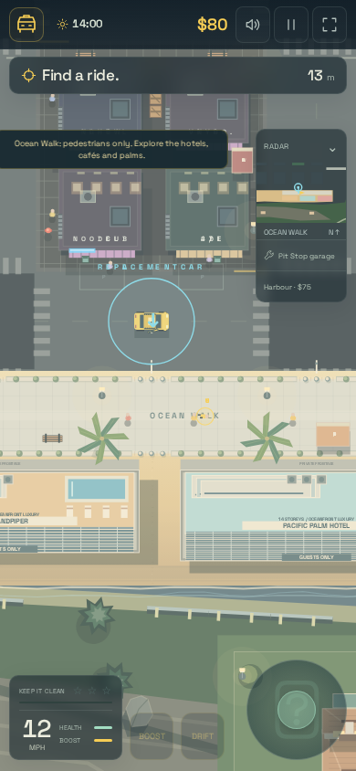
