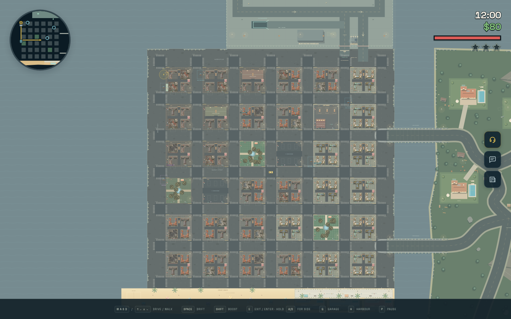
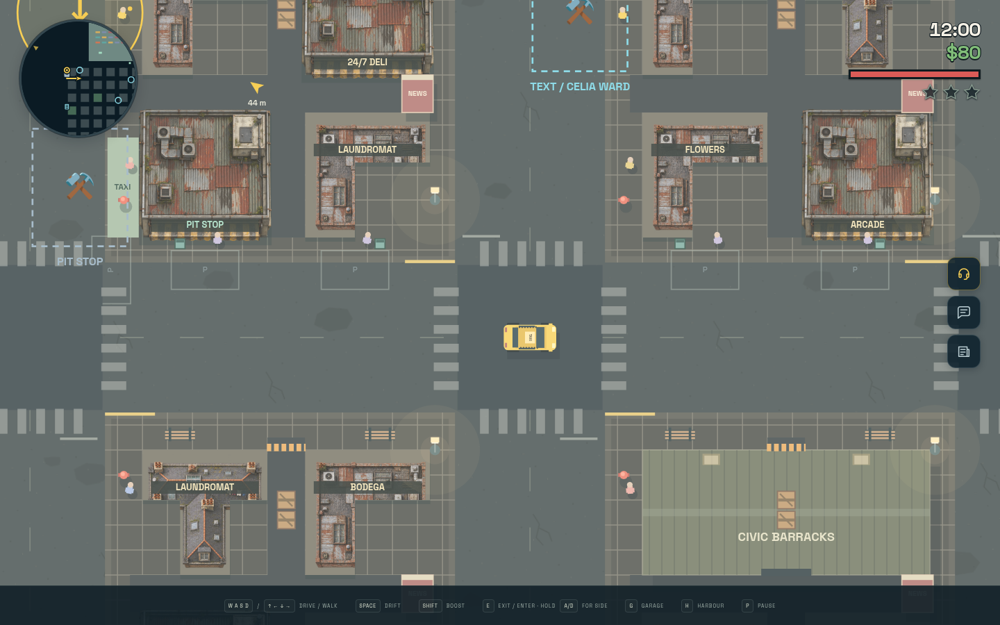
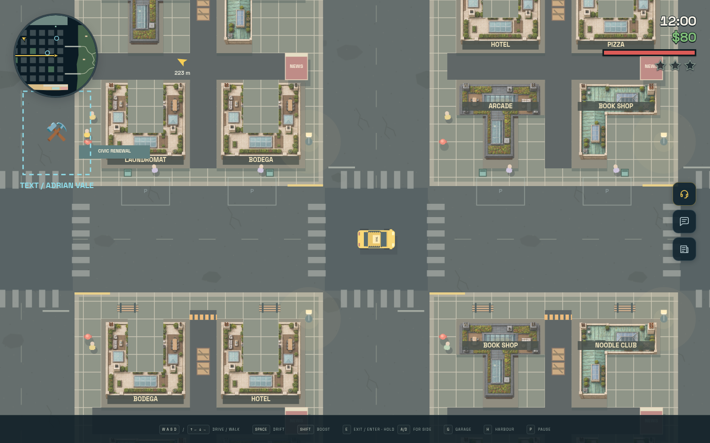
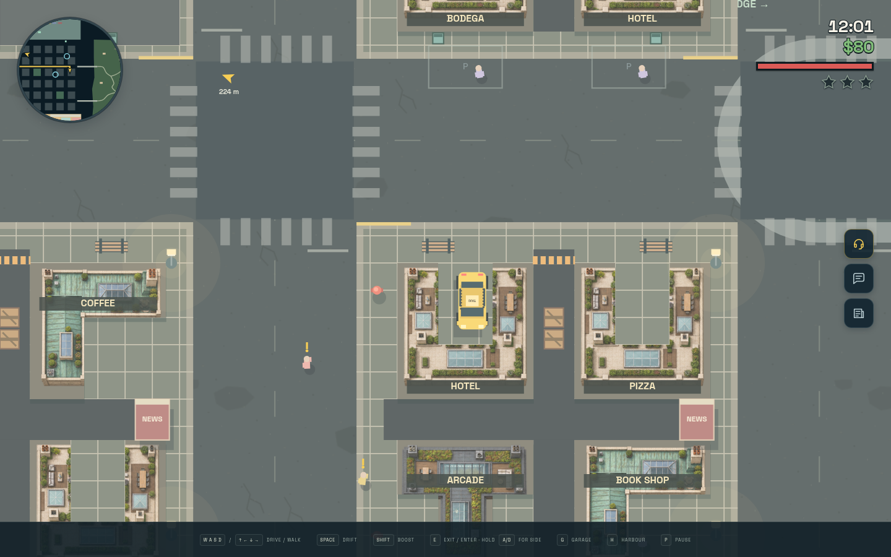

# City neighbourhood artwork

The city now has contiguous wealth clusters across all 36 blocks, with six new
embedded PNG roof designs. Materials, maintenance, roof amenities and paving
communicate the differences: patched metal and tar in Foundry Ward; brick, slate
and terracotta in Market Quarter; copper, limestone, timber decks, glass and roof
gardens in East Gardens. The existing three shop roofs stay interspersed through
the working and established areas. PIT STOP and HOSPITAL retain their footprints.

Rows run north to south; columns run west to east. W = working, M = established,
A = affluent. These are visual neighbourhoods, not changes to fares or residents.

```text
W W W M M A
W W M M A A
W W M M A A
W M M M A A
M M M A A A
M M M M A A
```

`src/city-neighbourhoods.ts` owns the frozen block palette, roof assignments and
physical geometry. The L workshop/copper roofs, T tenement/pavilion roofs and U
courtyard/limestone roofs each fit inside an original 10 × 10 m plot. They use two
or three nonoverlapping rectangular bodies. The removed corners and courtyards
are physically open; no full-square invisible building remains beneath the image.
Full taxi bodies can enter the L and U recesses. Existing roads, alleys, sidewalks,
mission markers and authored map documents retain their geometry.

The primary body draws the whole roof once, translated from the same part offsets
used for physics. Its image and sun shadow follow the concave outline. Every wing
supplies its own convex headlight occluder, including during image failure; never
use the convex hull of an entire courtyard, which would block its opening.
Image failure draws each physical rectangle procedurally. Dead props still use
the established destruction path; city buildings retain their infinite strength.

Primary lot IDs use grid and slot coordinates. Wings are appended after existing
world construction, preserving unrelated generated prop IDs and all RNG draws.
Visual lookup returns cached artwork records and does not create images, canvases
or ground patterns per frame. The asphalt raster/cache from PR #41 is retained.
No map schema or saved-map migration is needed; the read-only city is generated
from the same definitions in normal play, editor previews and map validation.

The six images are original generated game art. Full prompt and export details
are in [map-artwork-prompts.md](map-artwork-prompts.md). Assets and all decoding stay
embedded in the single offline HTML build. Credits now describe the mixed
procedural and illustrated artwork accurately.

Validation uses `npx vitest run --maxWorkers=1 --testTimeout=30000`, `npm run build`,
`npm run map:check` and `CHROMIUM_PATH=/usr/bin/chromium node tools/artwork-check.mjs`.
The browser check tours every neighbourhood, verifies all nine roof images draw,
physically drives into and reverses out of a courtyard, checks desktop/touch and
day/night scenes, destroys a tree, exercises real keyboard/native touch input and
repeats driving with every image disabled.
The production HTML is served from an in-memory Playwright route in offline
contexts, with no real network requests or local server required.

Verified: 740 tests in 60 files passed, strict TypeScript and the standalone build
passed, and map validation reported zero errors and zero warnings. The offline
browser checks passed at 1440 × 900, 390 × 844 and 844 × 390, plus deliberate image
failures, with no browser errors or external requests.





