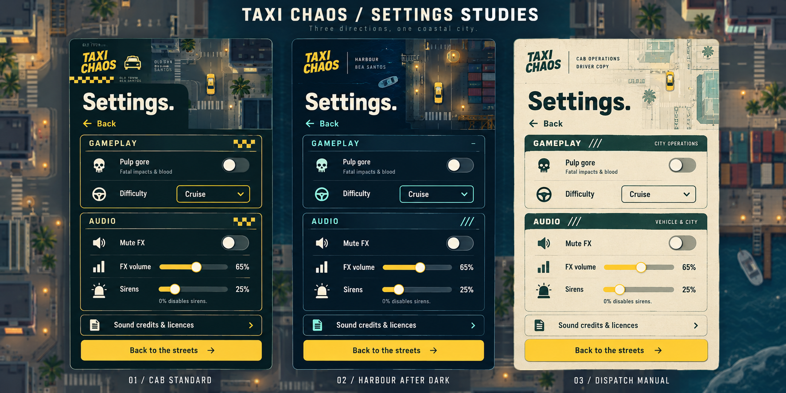

# Taxi Chaos settings studies

Visual exploration, 15 October 2026. These are generated concept mockups, not screenshots of implemented settings. Control labels and decorative map details are illustrative.

[Open the full-size concept board](settings-studies.png).

The board develops the supplied Arcade Cab, Night Shift, and Field Manual concepts around the existing game's muted coastal palette, top-down geometry, dark teal panels, cream type, and taxi-yellow actions.

| Direction | Development | Suggested use |
| --- | --- | --- |
| Cab Standard | Dark petrol teal, cream text, yellow controls, compact checker accents, and an overhead city vignette. | Main settings direction; closest to the existing garage and menu styling. |
| Harbour After Dark | Slate navy, mint accents, warm dock lights, and a small overhead harbour vignette. | Nighttime variation using the same layout and controls. |
| Dispatch Manual | Warm ivory, forest-teal text, restrained street-map lines, and yellow controls. | An alternate paper treatment, also worth exploring for the campaign notebook. |

## References reviewed

- [Current garage](../../screenshots/vehicle-upgrades/garage-desktop.png)
- [Circular radar and city gameplay](../../screenshots/circular-radar/desktop.png)
- [Start menu](../../screenshots/start-pause/start-desktop.png)
- [Beach](../../screenshots/beach/open-seafront-desktop.png)
- [Harbour at night](../../screenshots/harbour-night.png)
- [Woodland villas](../../screenshots/woodland-villas.png)

## Recommended direction

Develop Cab Standard with the current game's Space Grotesk typography, restrained borders, and generous spacing. Keep checker details small and preserve readable controls over opaque surfaces. Harbour After Dark can supply nighttime atmosphere; Dispatch Manual can inform notebook presentation.

Any implementation should retain the actual settings and behavior, keep gore opt-in, and verify keyboard focus and compact touch layouts. The illustrated backgrounds are concept art; production should use the real game renderer and shared geometry.
