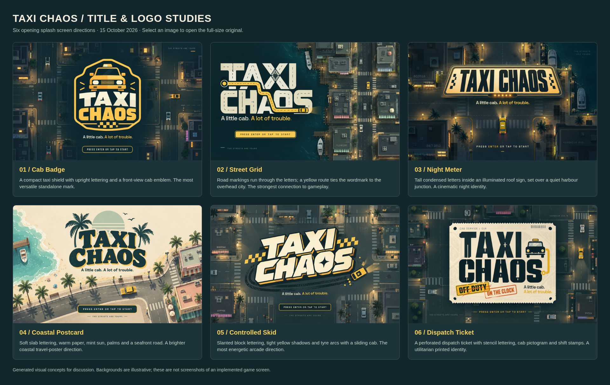
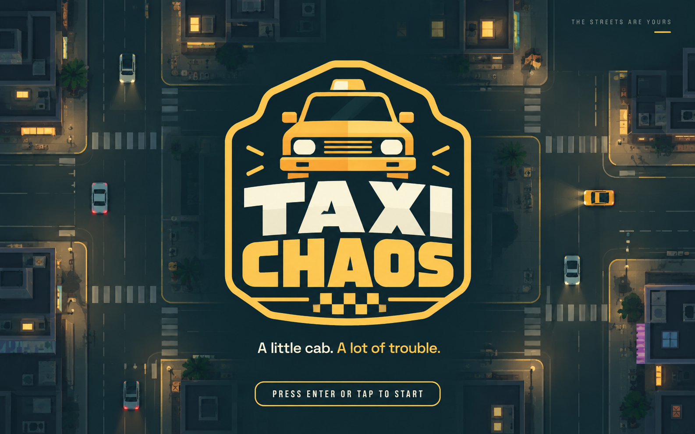
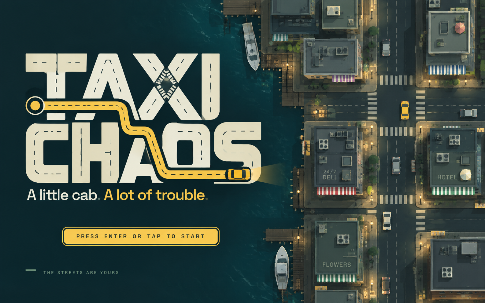
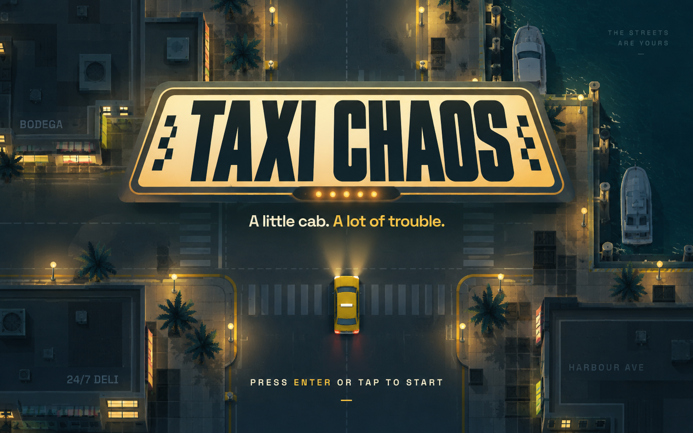
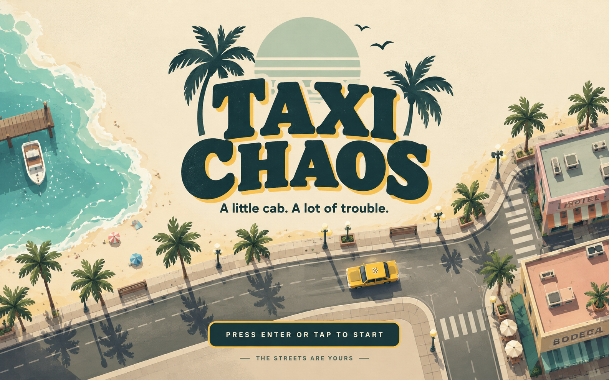
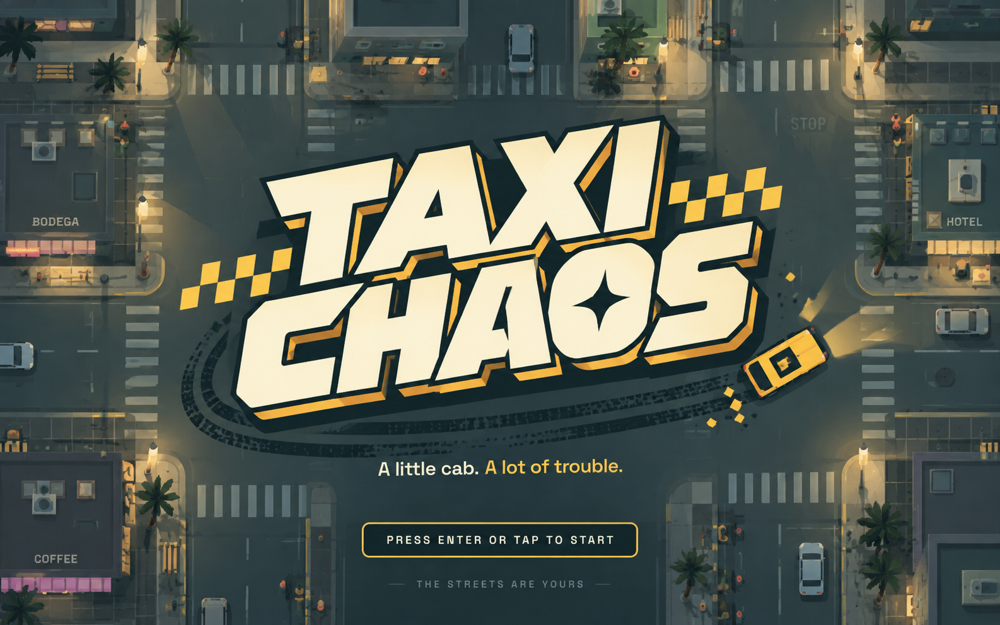
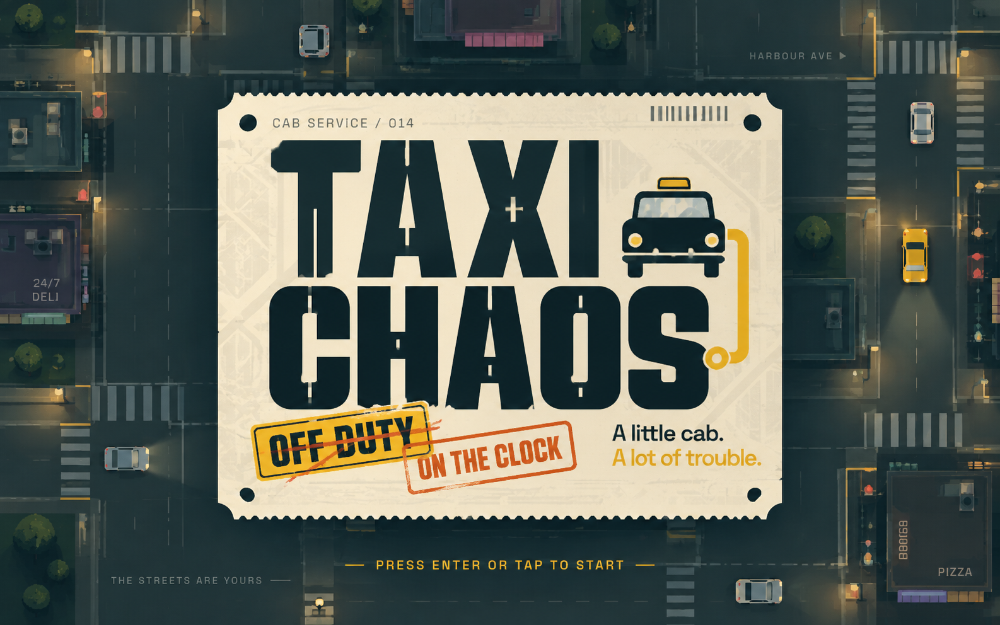

# Taxi Chaos: six title and logo concepts

Opening splash screen studies, 15 October 2026. Each image explores a distinct title/logo and its opening-screen composition, grounded in the existing top-down coastal game aesthetic. These are generated visual concepts, not implemented screens or production vector logos.

[Open the comparison board](comparison-board.png) · [Download the offline HTML gallery](comparison-board.html)

| Concept | Direction | Full-size image |
| --- | --- | --- |
| 01 / Cab Badge | A compact taxi shield with upright lettering and a front-view cab emblem. The most versatile standalone mark. | [Open PNG](01-cab-badge.png) |
| 02 / Street Grid | Road markings run through the letters; a yellow route ties the wordmark to the overhead city. The strongest connection to gameplay. | [Open PNG](02-street-grid.png) |
| 03 / Night Meter | Tall condensed letters inside an illuminated roof sign, set over a quiet harbour junction. A cinematic night identity. | [Open PNG](03-night-meter.png) |
| 04 / Coastal Postcard | Soft slab lettering, warm paper, mint sun, palms and a seafront road. A brighter coastal travel-poster direction. | [Open PNG](04-coastal-postcard.png) |
| 05 / Controlled Skid | Slanted block lettering, tight yellow shadows and tyre arcs with a sliding cab. The most energetic arcade direction. | [Open PNG](05-controlled-skid.png) |
| 06 / Dispatch Ticket | A perforated dispatch ticket with stencil lettering, cab pictogram and shift stamps. A utilitarian printed identity. | [Open PNG](06-dispatch-ticket.png) |

## Individual screens

### 01 / Cab Badge

A compact taxi shield with upright lettering and a front-view cab emblem. The most versatile standalone mark.

### 02 / Street Grid

Road markings run through the letters; a yellow route ties the wordmark to the overhead city. The strongest connection to gameplay.

### 03 / Night Meter

Tall condensed letters inside an illuminated roof sign, set over a quiet harbour junction. A cinematic night identity.

### 04 / Coastal Postcard

Soft slab lettering, warm paper, mint sun, palms and a seafront road. A brighter coastal travel-poster direction.

### 05 / Controlled Skid

Slanted block lettering, tight yellow shadows and tyre arcs with a sliding cab. The most energetic arcade direction.

### 06 / Dispatch Ticket

A perforated dispatch ticket with stencil lettering, cab pictogram and shift stamps. A utilitarian printed identity.

## Suggested shortlist

Street Grid most directly expresses the driving and navigation loop. Cab Badge is the clearest compact identity for a reusable icon. Controlled Skid gives the splash the strongest arcade energy.

## Reference and implementation notes

- [Existing opening screen](../../screenshots/splash/desktop.png)
- [Existing city and radar](../../screenshots/circular-radar/desktop.png)
- [Earlier settings studies](../settings/README.md)
- Preserve the large title, tagline, and one start prompt as the splash hierarchy.
- Background geometry in these images is illustrative; use the real renderer and shared map in production.
- Redraw a selected mark as original vector artwork before integration. Verify lettering at small sizes and provide compact portrait layouts.
- These PNGs contain flattened backgrounds, not isolated transparent logo assets. No game code or startup behavior changes in this study.
