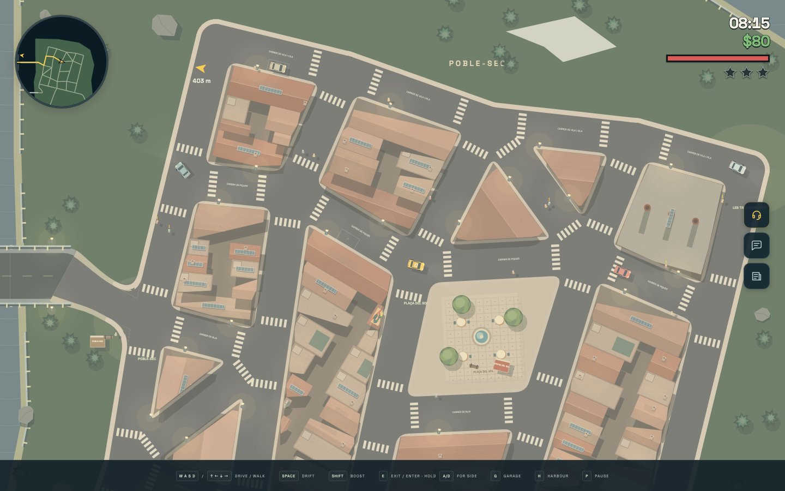
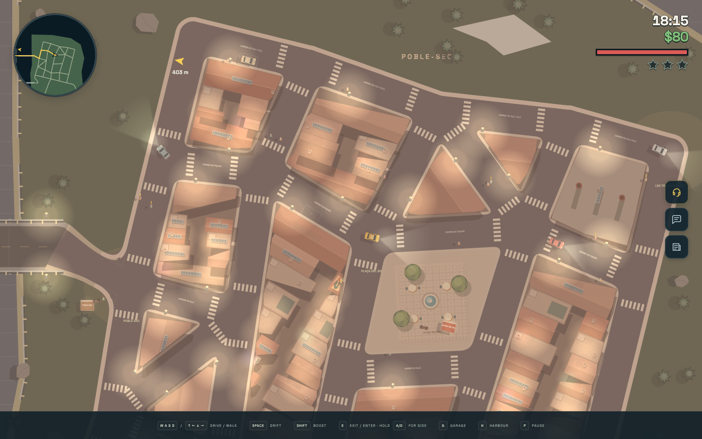
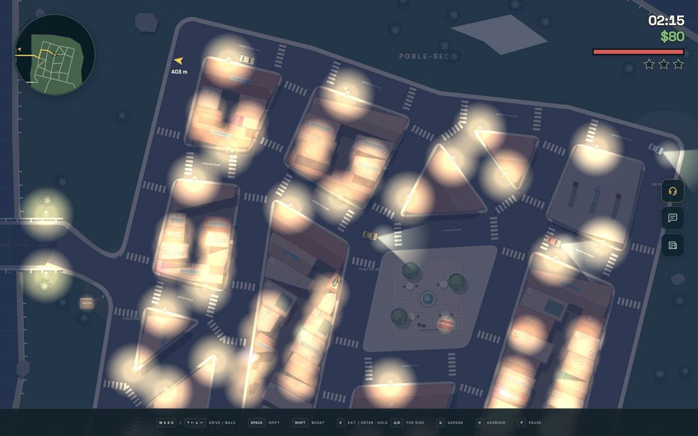

# Poble-sec and Parc del Mirador

The northern forest estates have been replaced by a residential neighbourhood inspired
by Barcelona's Poble-sec, below Montjuïc. Irregular courtyard blocks, triangular wedges
and terracotta tenements connect Pine Bridge and Fern Bridge to the southern roads.
The southern estates and Fairway Country Club remain accessible.

## Residential activity

The civil clock controls bounded local traffic and pedestrians:

| Local time | Moving residential vehicles | Walking residents |
| --- | ---: | ---: |
| 07:00–09:00 and 17:00–20:00 | 10 | 18 |
| Other hours from 06:00–22:00 | 6 | 11 |
| 22:00–06:00 | 2 | 3 |

These are population targets, excluding parked cars, destination visitors and customers.
Changes settle away from the driver; visible people and vehicles remain physical. Burning
vehicles retain their fuses, wrecks retain their normal lifecycle, and passengers and the
player's current vehicle are protected. Residential road traffic chooses connected local
streets. Residents walk loops along the actual compiled curbs rather than wandering
against the houses. Laboratory traffic controls retain their explicit counts.

## Authored geometry

Version 3 of the map document stores explicit block corner references, a neighbourhood
frame, residential road surfaces, building roof styles, murals and convex footprints.
Each building has one stable identity and one footprint shared by collision, pedestrian
clearance, roofs, light occlusion and the editor. No runtime consumer parses building IDs
or suppresses placeholder lots. Renaming, moving, resizing, duplicating and deleting a
building use the normal atomic map operations and undo/redo. Older schema versions are
rejected rather than silently converted.

The overlapping courtyard infill has been removed. The three industrial chimneys are
rooftop artwork on the industrial building, avoiding duplicate intersecting solid bodies.
The bundled dragon mural remains original SVG artwork; no satellite imagery or remote
assets are requested. The planted Mirador paths and terraces use planar vehicle physics.

## Fares and parcels

The shared destination catalogue now names **Poble-sec**, **Parc del Mirador**,
**Les Tres Xemeneies** and **Plaça del Sol**, replacing the former forest destinations.
The plaza's stop references its existing café explicitly. Other stops reserve clear roadside
amenities. Both everyday fares and motorcycle parcels use these destinations, with road
route distance determining pay and available time. The Mirador connects to the southern
estates through both existing approaches.

For a scenic drive, press **F2**, choose **Poble-sec / Mirador**, then **Run**.
The scenario disables police and routes the passenger to Parc del Mirador.
Automation can use `__taxi.scenario('eastern-bridges')`.

## Validation

`npm run map:check` validates the shipped map with zero errors and warnings and a
121.1 m sampled beachfront water gap. Regression tests cover morning/evening boundaries,
real population changes, RNG preservation, clear moving pedestrians, protected actors and
fuses, explicit geometry transactions, malformed imports, all four fare/parcel destinations,
and the existing southern driving routes.

`node tools/residential-check.mjs` checks the standalone HTML offline at 1440 × 900,
measures real traffic and pedestrian movement across four times of day, and writes screenshots
and a JSON report to `/private/tmp/taxi-residential` (or `SCREENSHOT_DIR`). Browser QA also
physically drove from Pine Bridge through the neighbourhood and southeast descent in
61.1 seconds at 100 HP, without mid-drive teleports or upgrades. Portrait (390 × 844), compact
(320 × 568), and landscape (844 × 390) views were checked for horizontal overflow.
