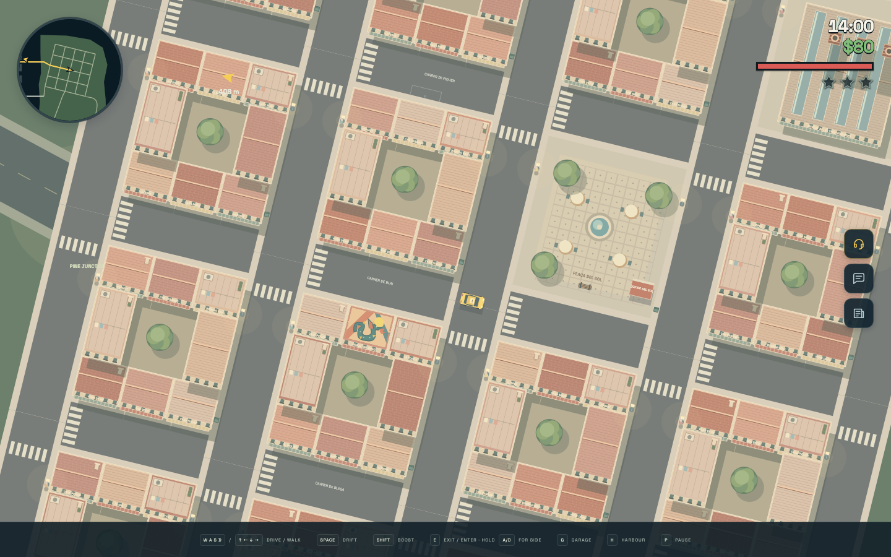

# Eastern Highlands: Barcelona experiment

This exploratory pass replaces the northern highland forest loop with a neighbourhood
inspired by the supplied satellite view of Barcelona's Poble-sec, below Montjuïc.
Sixteen angled blocks connect Pine Bridge and Fern Bridge to the existing southern roads.
The street network, building bodies, parking bays and street props live in the versioned
map document. Navigation and road rendering use the compiled map geometry.

The residential blocks use attached terracotta houses around planted interior courtyards.
Original Canvas artwork adds tiled and flat roofs, washing lines, rooftop planters,
chimneys, shutters, balconies and striped shop awnings. An open café square has a fountain,
tables and existing physical kiosks, benches and trees. A covered market and three small
industrial chimney landmarks echo the reference's Tres Xemeneies area.

An original bundled SVG dragon mural is painted on one roof. No satellite imagery or
online assets are requested by the standalone game. The hillside uses planted terraces,
switchback walking paths, a café and lookout benches; relief remains visual with the
existing planar vehicle physics.

Start the game, press **F2**, choose **Eastern Highlands / Barcelona experiment**, then
**Run**. Cross Pine Bridge and explore the new streets. The existing Eagle Lookout fare
uses its new map-authored position. The lab scenario disables police. Automation can use
`__taxi.scenario('eastern-bridges')`.

This is a disposable visual prototype. The production build and strict TypeScript check
complete; automated tests, map validation and driving/touch playtests were deliberately
skipped at the user's request. Screenshots were captured from the standalone HTML at
1440 × 900, with an overview camera for the first image.
