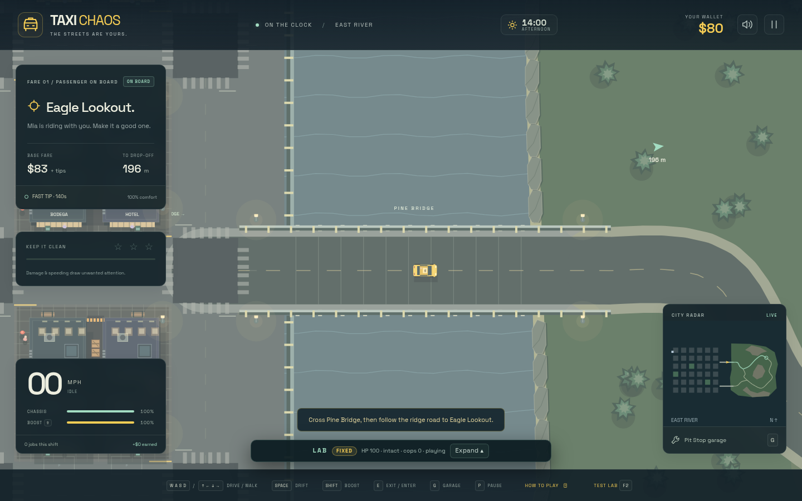
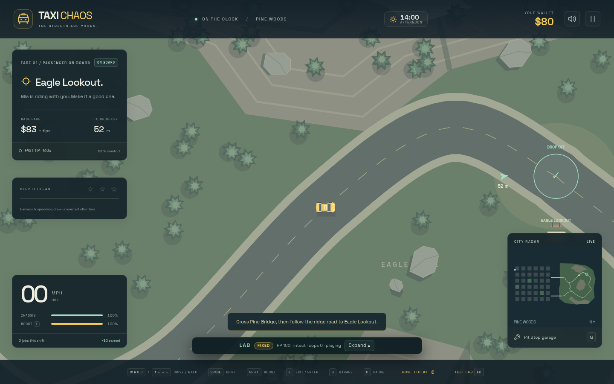
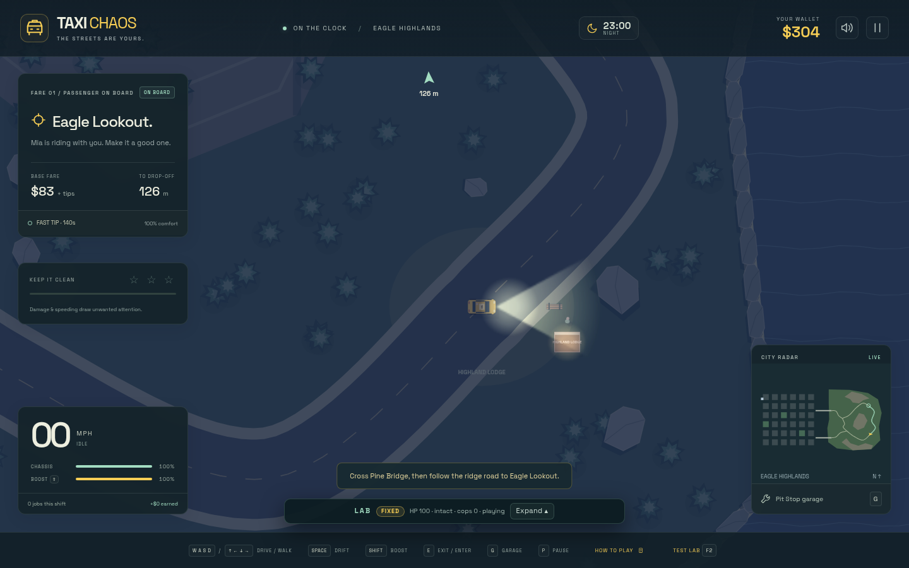

# Eastern bridges and highlands

Pine Bridge and Fern Bridge connect the eastern waterfront to Pine Woods and the Eagle
Highlands. The new area uses winding roads and an irregular shoreline, with forest
clearings, rocky ridges and four delivery stops: Pine Junction, Eagle Lookout, Highland
Lodge and Fern Hollow. Both bridges connect to a continuous road loop back to the city.

## Pine Bridge

The northern crossing leaves the city at y = 80. Solid rails protect the bridge deck;
the road bends into the woods on the far bank. Fern Bridge is the southern crossing at
y = 200. The expanded minimap shows both crossings and the complete highland road network.

## Eagle Ridge

Curved roads replace the city grid in the highlands. Navigation and civilian traffic
follow the same sampled curves that the renderer draws. Rural fares and parcel deliveries
use road distance to calculate travel time and pay, including the detour over a bridge.

## Highland Lodge at night

The new area uses the existing day/night cycle and headlights. Trees, rocks, bridge
rails and shoreline boundaries are solid scenery. Mountain relief is visual; vehicles
continue to use the existing planar driving physics.

## Explore the extension

Start the game, press **F2**, select **Eastern bridges / highlands**, then choose **Run**.
This scenario places the cab at Pine Bridge facing east with a passenger bound for Eagle
Lookout. Police are disabled for the scenic run. Return through the southern Fern Bridge
to complete the loop.

Browser automation can start the same scenario with
`__taxi.scenario('eastern-bridges')`. The screenshots above were captured from the
standalone production build at 1440 × 900, at 14:00 for the daytime views and 23:00 for
the nighttime view.
