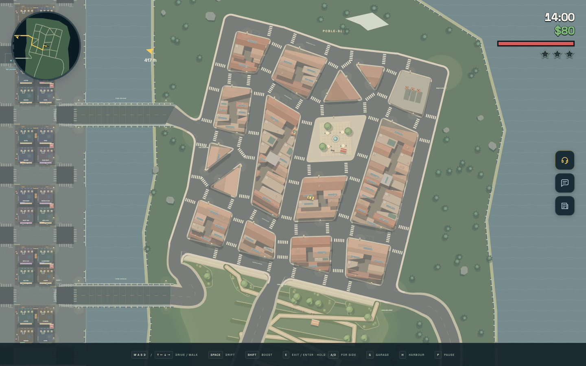
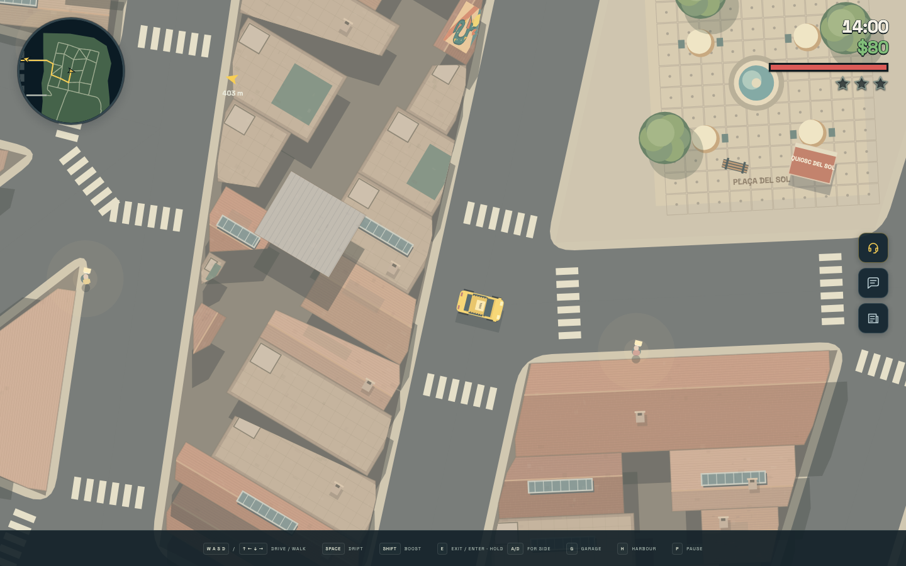
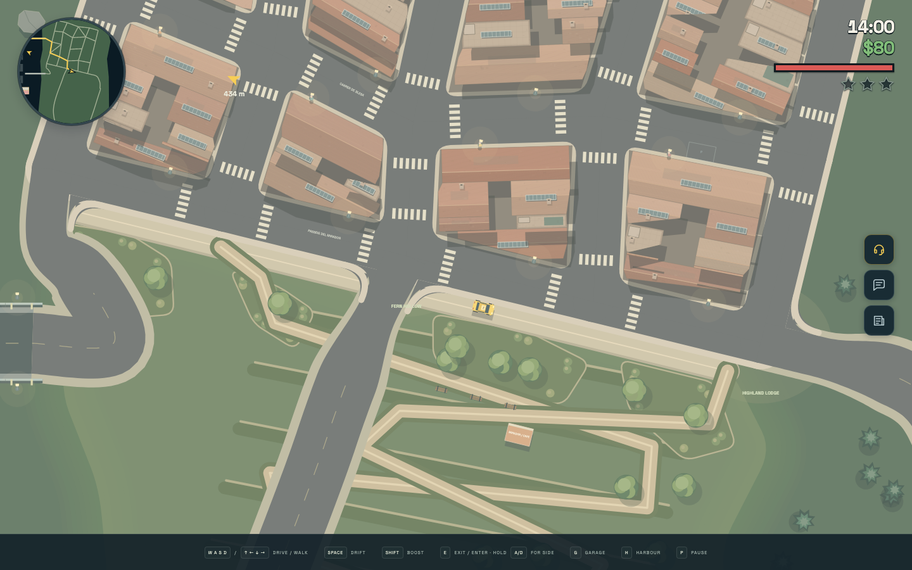
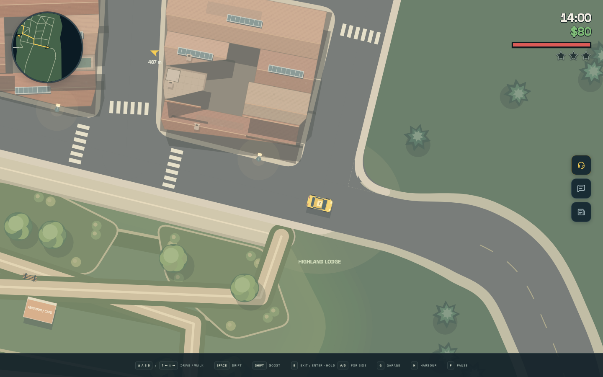
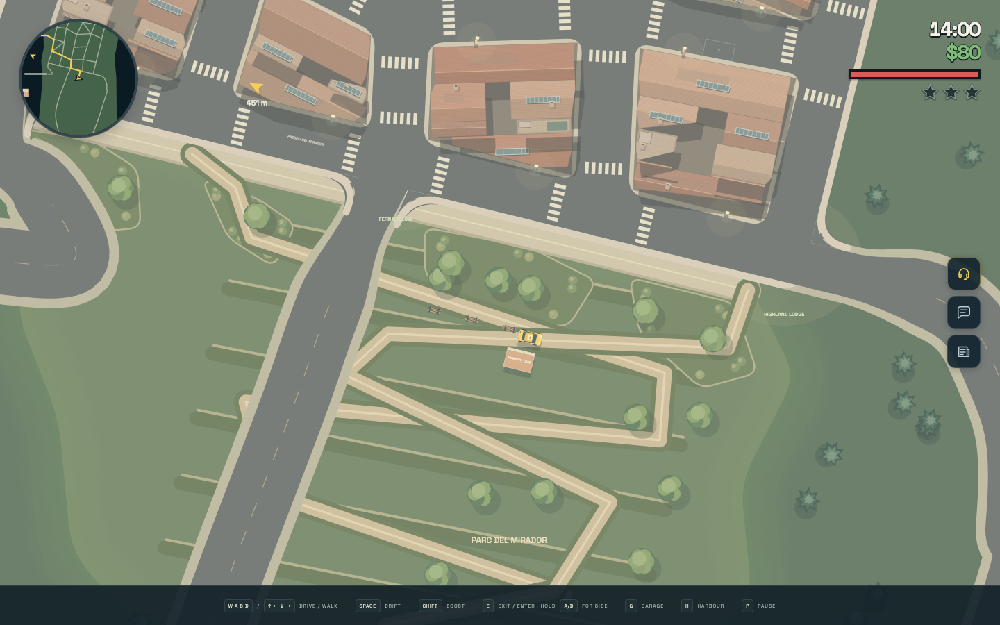

# Eastern Highlands: Barcelona experiment

This exploratory pass replaces the northern highland forest loop with a neighbourhood
inspired by the supplied satellite view of Barcelona's Poble-sec, below Montjuïc.
Irregular blocks, including triangular wedges, trapezoids and two longer tenement blocks, connect Pine Bridge and Fern Bridge to the existing southern roads.
The street network, building bodies, parking bays and street props live in the versioned
map document. Navigation and road rendering use the compiled map geometry.

Offset junctions and two diagonal passages break up the street grid. Buildings follow each street edge with individually rotated physical footprints. Residential plots share walls along the street and extend to varying depths around narrow, broken rear courts. Longer blocks include rear workshops and small lightwells. Each cadastral parcel compiles to one convex footprint shared by the physical body, roof silhouette and light occlusion.
Canvas artwork uses subdued terracotta pitches, roof terraces, stair heads, chimneys, repairs and elongated metal-framed rooflights. An open café square has a fountain,
tables and existing physical kiosks, benches and trees. A covered market and three small
industrial chimney landmarks echo the reference's Tres Xemeneies area.

An original bundled SVG dragon mural is painted on one roof. No satellite imagery or
online assets are requested by the standalone game. The hillside uses planted terraces,
switchback walking paths, a café and lookout benches; relief remains visual with the
existing planar vehicle physics. A planted promenade, low garden beds and spaced street
trees ease the transition from the last residential row into an irregular, softly blended
park outline. Walking paths connect directly to the promenade.

Pavement corners are rounded, crossings sit back from the intersections, and the wider
country approaches taper into the neighbourhood streets. All connected curbs are drawn
before the road surfaces, keeping the southeast exit open without a curb across its mouth.
The inside corners at these approach junctions use sampled curves; the Fern landing bends
inland to clear the bridge rail. Road curves remain shared with routing and sensing.

Start the game, press **F2**, choose **Eastern Highlands / Barcelona experiment**, then
**Run**. Cross Pine Bridge and explore the new streets. The existing Eagle Lookout fare
uses its new map-authored position. The lab scenario disables police. Automation can use
`__taxi.scenario('eastern-bridges')`.

This remains an experimental map. The production build and strict TypeScript check pass,
as do three focused tests for Fern car/truck clearance, promenade planting and recompilation.
An isolated, offline browser drove from Pine Bridge through the residential streets and
southern junctions and southeast descent in 61.1 seconds with no damage, teleports during the drive or upgrades.
Portrait (390 × 844), compact (320 × 568) and landscape (844 × 390) views had no horizontal
overflow. No console errors or external requests were observed. The southeast connection
was also inspected in daylight and at night.

The full suite reports 694 passing tests and 11 failures, down from 13 failures before this
pass. Map validation reports 12 existing errors, down from 24 after removing duplicate park
trees and clearing the Fern landing: eight building-overlap findings and four unavailable
fare-stop clearings remain. Invalid editor drafts continue to block gameplay preview.
Screenshots use the standalone HTML at 1440 × 900, with an overview camera for the first image.
