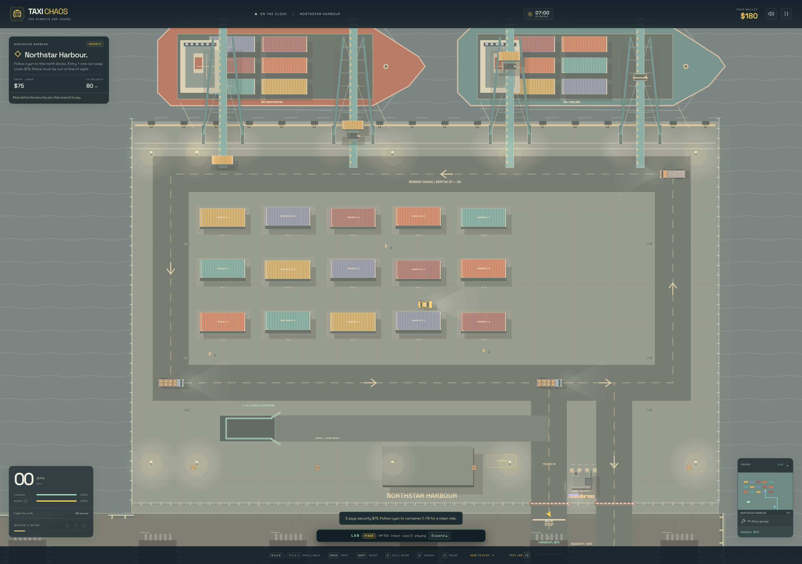
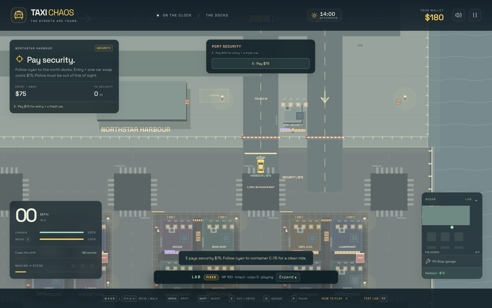
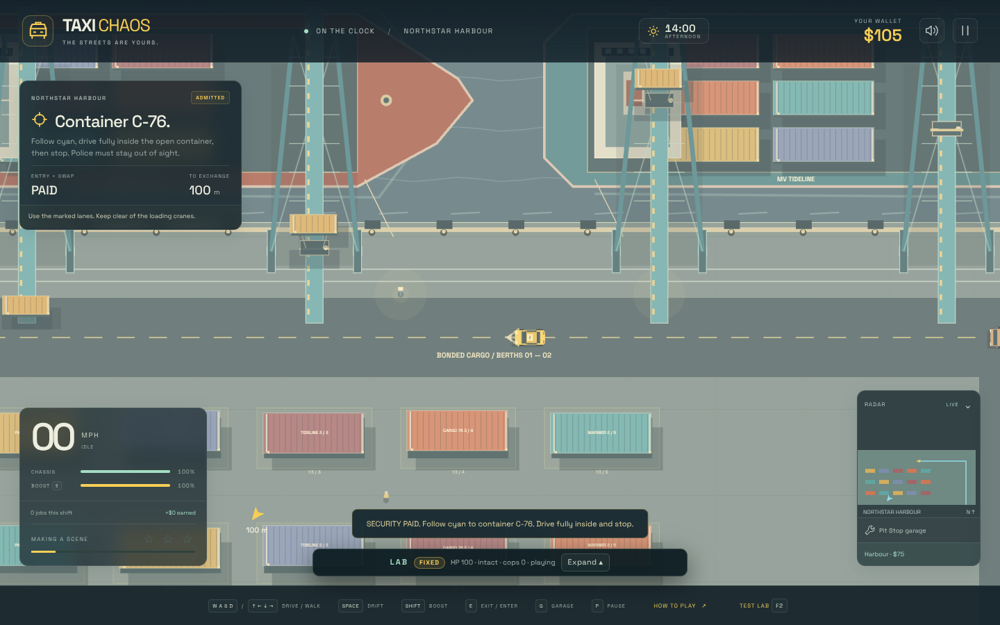
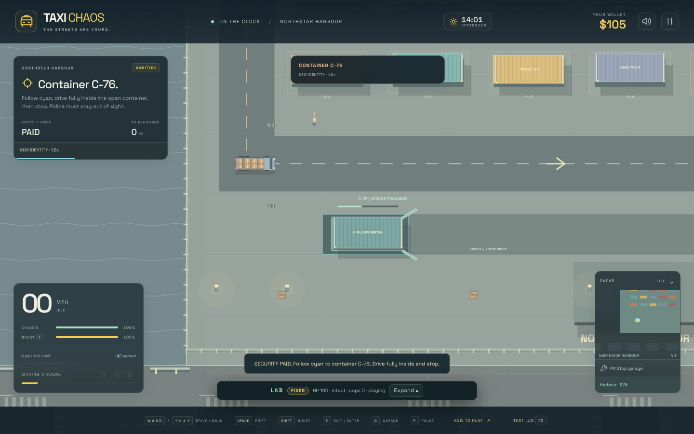
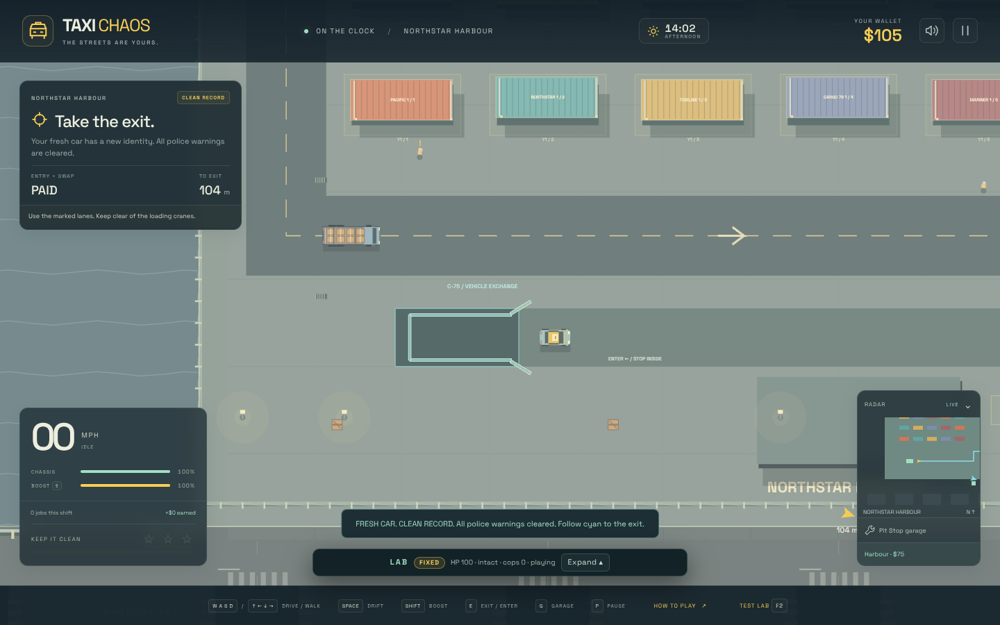
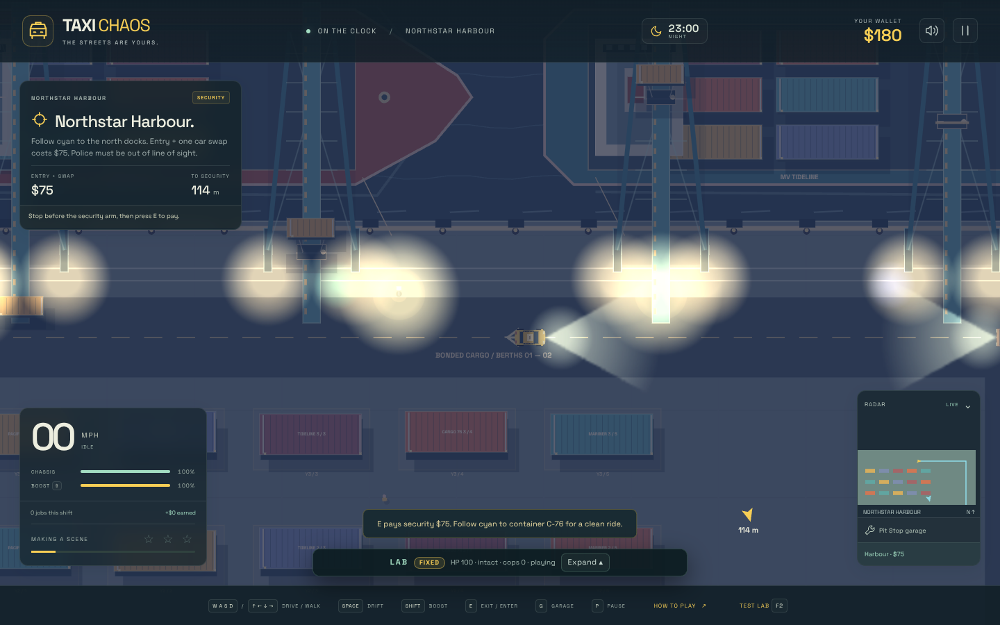
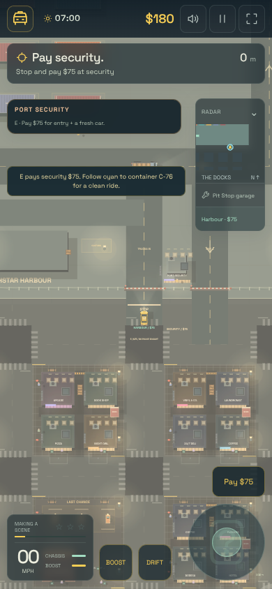

# Northstar Harbour

A working container terminal extends the city northward: a 180 × 120 m drivable
apron, fifteen container stacks, two moored cargo ships, four animated loading
cranes, customs/security buildings, dock workers, and three physical freight NPCs.
Containers, crane feet, fences and the security arms have real collision geometry.
The quay remains open to the ocean; driving beyond it uses the existing sinking
and hospital recovery lifecycle.

## References inspected before implementation

- [OneOcean: docked container vessels and gantry cranes](https://www.oneocean.com/insights/the-ins-and-outs-of-ship-chartering), including its aerial terminal photograph. Inspired the clear quay apron, parallel storage rows, crane tracks, truck circulation and separate gate lanes.
- [Sylvain Sarrailh harbour artwork, collected by Character Design References](https://characterdesignreferences.com/artist-of-the-week-5/sylvain-sarrailh), especially the colourful container-port painting. Inspired turquoise crane steel, warm container colours, readable industrial shapes and a tucked-away exchange container.

The reference images were inspected for inspiration. All game artwork is original
procedural Canvas drawing; no third-party image assets or runtime requests were added.

## Play the car exchange

1. Press **H**, or tap **Harbour · $75** below the radar, to route to the north gate.
2. Arrive **in a car**, slow below 2 m/s and break police line of sight. Bikes,
   commercial vehicles, wrecks and burning cars are refused. Security checks actual
   police visibility, including sub-star warnings; zero stars are not required.
3. Press **E**, or tap the security payment button. **$75** buys admission and one
   exchange. Both gates admit that specific car; freight permission cannot be used
   to tailgate through without paying.
4. Follow cyan to **C-76**. Approach from the east, drive fully inside, release
   acceleration and stop below 0.8 m/s. Stay concealed for **2.5 seconds**. Moving,
   leaving the container, exiting on foot, a fire or renewed police visibility
   resets progress. An occupied emergence bay delays completion safely.
5. A different-coloured, healthy car appears outside the doors. Its vehicle ID is
   new; damage is fresh and boost is full. Wallet, upgrades, the current fare and
   any aboard passenger carry over. The exchanged car is removed into storage.
6. Heat, stars, escape/arrest timers, speeding accumulation, shared police intel
   and all active pursuers clear immediately, including warnings below one star.
   There is no escape reward for this paid service. New crimes still attract police.
7. Follow cyan to the outbound lane. Admission expires on departure; another visit
   requires another payment. Run reset, hospital discharge and tow/bail recovery
   clear admission too. Emergency **E** bailout still works at the security gate.

## Simulation and extension points

- `src/harbour.ts` owns the shared dry-land bounds, gate locations, route graph,
  exchange geometry/timing/fee, storage rows, ship/crane descriptors and deterministic
  loading cycle. Update these definitions to change the layout or service rules.
- `src/world.ts` generates physical container shells/stacks, gate/fence colliders,
  warehouses, crane feet, lamps and workers. Separate worker RNG preserves city
  layout and traffic seeds. `src/coast.ts` uses the same land footprint and removes
  the former north-shore rails where the new apron joins the city.
- `roadPath`, `roadDistance`, `roadProjection` and `roadNeighbours` connect the
  harbour graph to both the city and woodland. Existing top-street lanes keep their
  city routing; normal traffic does not randomly choose the restricted gate.
- Three empty/loaded trucks follow `FREIGHT_ROUTE`, passing through inbound and
  outbound security lanes and a city circuit. They use the existing vehicle mass,
  inertia, tyre forces, braking, sensing and collision/recovery AI, with a port
  speed cap. Harbour freight is separate from the ordinary traffic-density slider.
- `src/harbour-renderer.ts` draws ribbed/tiered containers, ship hulls, deck cargo,
  bridges, mooring ropes, fenders, bollards, drainage, road arrows, fence mesh,
  gate arms, crane latticework and an attached cargo lift/transfer/lower cycle.
  Crane spans are overhead; their feet are solid. Animation consumes no gameplay RNG.
- Containers occlude headlights and police vision. Police sight uses exact segment
  intersections with oriented bodies so the thin exchange walls cannot fall between
  sampled rays. Gate/fence mesh remains transparent to police vision.
- `Game.harbour` tracks the admitted vehicle, entry, consumption and exchange progress.
  `Game.enterHarbour()`, `Game.updateHarbour(dt)` and `Game.navigateHarbour()` expose the
  gameplay actions. `Game.snapshot().harbour` returns detached service/visibility state.
- **F2 → Northstar Harbour / car exchange** loads the stopped car at security, $180,
  a sub-star warning and three trucks. Automation: `__taxi.scenario('harbour')`.

## Verification

Rebased onto the mobile HUD update with joystick, fullscreen, contextual actions and the compact status widget retained. Browser checks cover five viewport layouts and native two-finger input, plus harbour payment, exchange and exit on small phones, portrait and landscape; no overlapping controls or browser errors. The mobile mission shows harbour-specific instructions.

`npm test -- --maxWorkers=2 --testTimeout=20000` passes **359 tests / 26 files** and `npm run build` passes against the latest main, including consolidated game-over billing and the mobile thumb controls. Harbour integration tests cover land/sea,
city/woodland navigation, complete truck clearance, security collisions, exact fee
charging, eligibility, thin-wall visibility, interrupted exchanges, blocked output,
new-car identity, passenger/wallet/upgrades, complete pursuit reset, later crimes,
admission expiry and emergency bailout. A five-minute physical freight run crosses both gates and completes the port/city circuit at 100% health.

Production Chromium checks exercised the real security button, drove the entire
gate-to-container route through normal steering/pedal physics with zero damage,
checked the countdown and output car, drove out through security at 100% health, checked the night view and a 390 × 844
mobile viewport, and found no runtime errors or horizontal overflow. Scene placement
and clock were controlled through the existing LAB API for reproducible screenshots.

