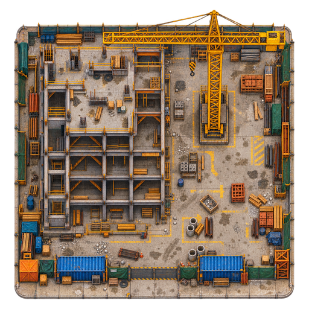
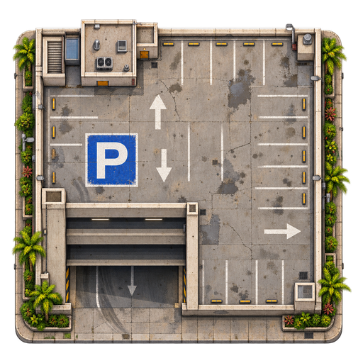
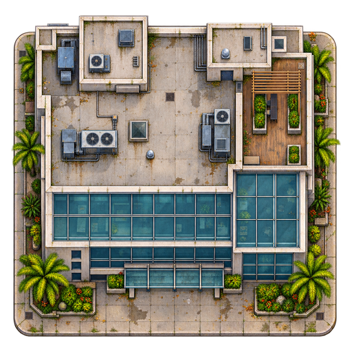
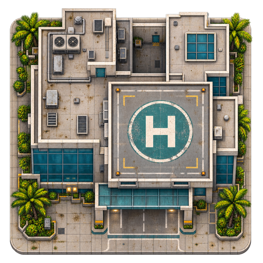

# Concept-inspired landmark assets

Four separate transparent landmark sprites, inspired by the user's construction /
parking / office / hospital concept sheet and the established weathered city art.

| Asset | Visual identity | Placement considerations |
| --- | --- | --- |
| `construction-site.png` | Exposed frame, yellow tower crane, raw slabs, stockpiles and blue storage containers | Author individual solids and traversable construction lanes. |
| `parking-garage.png` | Open parking deck, marked bays, visible ramp and blue P marker | Keep ramp access and actual parked vehicles separate from the image. |
| `office-building.png` | Concrete service roofs, blue-green glazing and a roof terrace | Align the entrance canopy and distinguish terrace decoration from collision geometry. |
| `hospital.png` | Pale roof wings, teal accents, rooftop H landing marker and receiving canopy | Author the arrival apron and entrance for real game actors. |

Files live in `src/assets/map/landmarks/`. Each game-ready PNG is 512 × 512 pixels,
RGBA, with at least a transparent 16-pixel export margin. The occupied art is fitted inside
the remaining 480 × 480 pixels with its aspect ratio preserved. The drawing anchor
is the centre of the canvas; north is at the top. Full-resolution generated images
are retained by the image-generation output.

These are asset deliverables. Map placements, physics bodies, vehicle spawns,
lighting outlines and gameplay behaviour are authored separately when a location
is added. The image itself does not define a solid collision rectangle. Runtime
image imports should follow the shared loading/raster caching path described in
[map-artwork.md](map-artwork.md).

The static art leaves vehicles and people to the game. The hospital uses a white
H and teal landing-pad marking. Original generation prompts and the preparation
method are recorded in [landmark-artwork-prompts.md](landmark-artwork-prompts.md).

## Asset previews

## Verification

All four PNGs decode successfully as RGBA, have dimensions 512 × 512, retain full
transparency and opacity, and keep their occupied pixels inside the export margin.
The prepared office, hospital and construction sprites were visually inspected at
their exported size, alongside the original generation previews. Strict TypeScript
and the standalone production build passed. This asset-only change adds no runtime
imports or gameplay logic.
