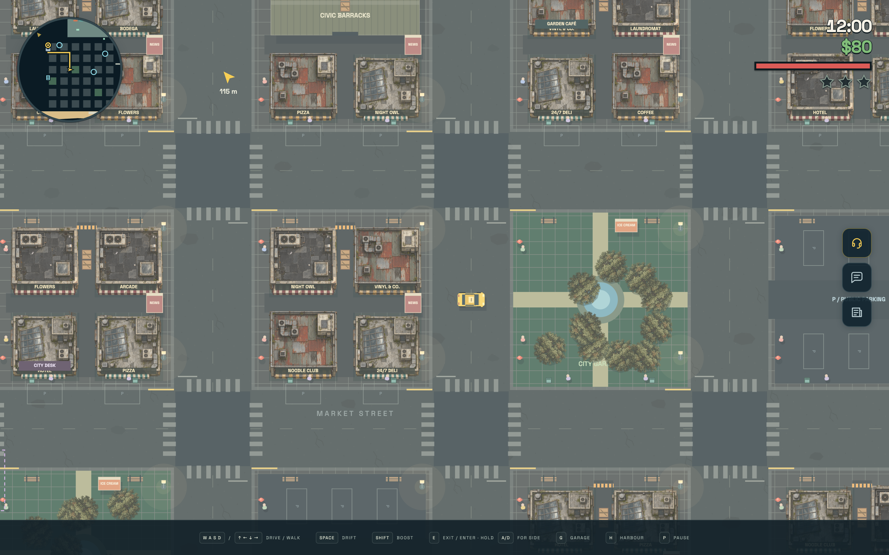
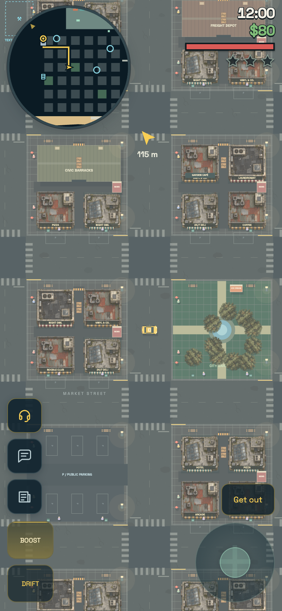
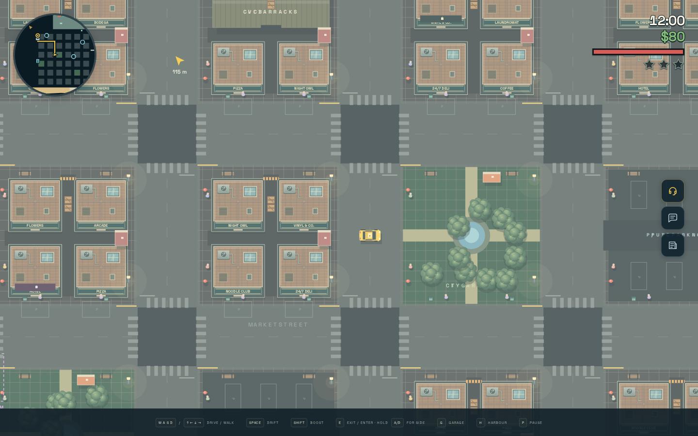
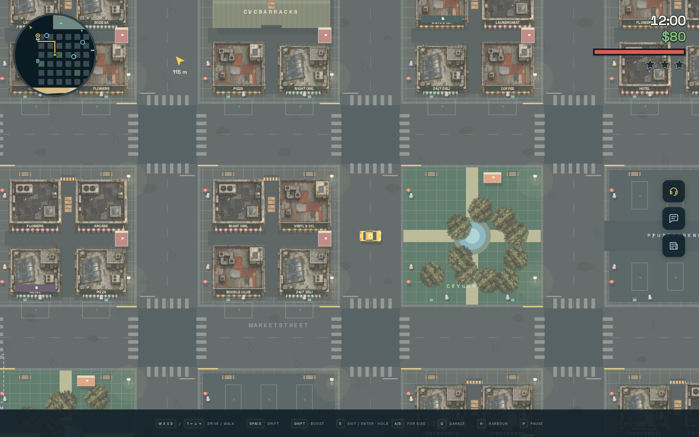
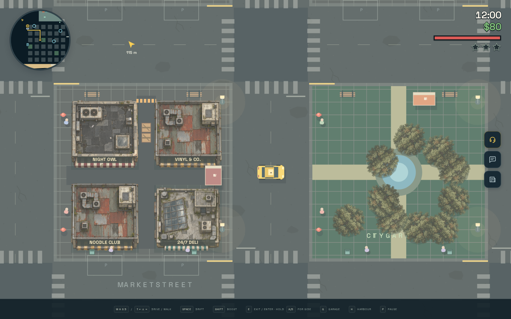
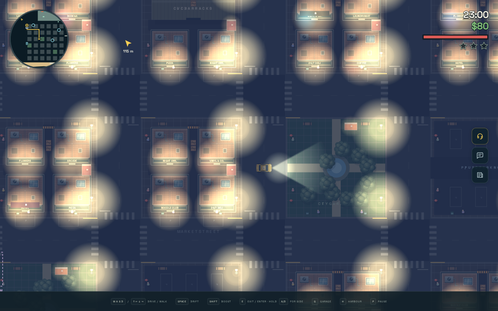
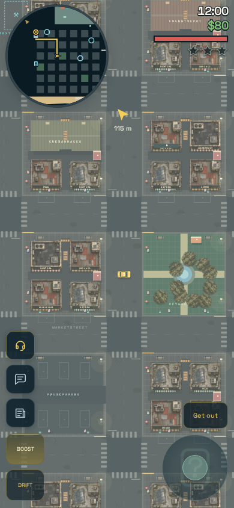

# Top-down map artwork

The first artwork pass replaces standard 10 × 10 m city shops and urban trees
with textured PNG illustrations, and adds asphalt grain, cracks and scattered
repairs beneath city blocks. Three distinct roof materials (patched tar, rusted
corrugated metal and weathered concrete) replace the uniform prototype roof.
An irregular urban tree is reused in four deterministic orientations. Other buildings, the countryside, harbour and beach keep their procedural
art. Vehicle, pedestrian, map and collision data are unchanged.

## Where to work

- `src/assets/map/`: self-contained image files (transparent PNG sprites and an SVG ground tile).
- `src/artwork/catalogue.ts`: image identity, bounds in metres, collision-centred
  alignment, stable visual variants, sun-shadow silhouette and optional directed-light occluder.
- `src/artwork/images.ts`: explicit `?inline` imports, shared image decoding, one-time
  SVG ground rasterization and cached world-anchored ground patterns.
- `src/renderer.ts`: ground and structure passes, dynamic signs and fallback drawing.

The existing default appearance rules choose city shops by kind, size and position,
never by display name. A separate hash of source ID (or generated prop ID) picks
roof material and tree orientation, without consuming simulation randomness.
Moving or renaming an identified prop keeps its appearance. No map schema change or saved-map migration is needed for
this first pass. Add authored visual IDs when individual map objects need distinct
styles; do not use their labels as asset identifiers.

## Artist contract

All artwork uses a straight overhead view, with north at the top. The anchor is the
collision body's centre. Bounds describe the *entire image*, including transparent
padding, relative to that anchor. A 256 × 256 shop image occupies 10.6 × 10.6 m:
its bounds start at (-5.3, -5.3), while its physical body stays 10 × 10 m. Urban
tree art occupies 5.2 × 5.2 m around its existing 1.8 × 1.8 m collision body.

Keep the shop sign panel blank; runtime text retains the real business name. Avoid
baked cast shadows: the renderer paints a separate silhouette displaced by the
current sun. Local roof/leaf shading can stay in the image. An optional convex
occluder blocks headlight cones; it is independent of both the image bounds and
collision body, and rotates with the prop. Trees retain their existing soft-light
behaviour; their canopies do not become solid walls or new headlight blockers.

To add an image, import it with `?inline` in `images.ts`, register its image ID and
metre bounds in the catalogue, and extend the narrow appearance rule. PNG imports
use the same path; no SVG-specific runtime drawing is involved. Use self-contained
SVGs without scripts, external images, fonts or references to other files. PNGs
should include transparency where needed. Supply enough pixels for the maximum
normal zoom and device pixel ratio; the pilot images exceed that requirement.

Images decode before the first game frame and are shared with editor previews.
A failed image falls back to procedural drawing and its original light occluder.
Dead props go through the existing rubble/destruction drawing before live artwork
is considered. Dedicated damaged or destroyed images can follow when a particular
asset needs them; this pass keeps the existing damage lifecycle.

The asphalt tile repeats every 48 m, anchored at world origin. It is transparent
grain and sparse repairs over the darker road colour, so daytime colour changes still work. Road
markings and sidewalks are drawn above it. Surface physics continues to use map
geometry, never pixel colours. Before the first playable frame, the SVG is rasterized
once to a shared 768 × 768 canvas (about 2.25 MiB). Each context caches its own pattern
from that immutable raster tile. **Never pass the live SVG image to `createPattern`:**
Chrome can move the world canvas onto a software rendering path, stalling even the
unchanged lighting compositor's `drawImage` calls. Rasterizing only after the first
frame is too late to reliably recover that canvas's acceleration. Decode/raster
failures retain procedural ground; PNG props, light masks and destruction are unchanged.

Ground artwork remains below props and actors. Shop/tree artwork uses the existing
structure pass; actors are drawn afterwards. Foreground canopy occlusion, stacked
floors and isometric depth sorting are outside this first top-down pass.

## Verification

`npm test` covers physical footprint independence, rotating light outlines,
destruction and procedural defaults. `npm run build` checks TypeScript and enforces
one standalone HTML with embedded assets. `node tools/artwork-check.mjs` exercises
the offline production build, actual PNG decoding/drawing and all three roof variants, missing-image fallback,
night lighting, physical tree destruction, fixed-step driving and compact touch
layouts. Screenshots are written to `scenario-runs/artwork` by default.

### Performance regression checks

`src/artwork/images.test.ts` verifies one-time rasterization, the raster-only pattern
source, per-context caching, image/raster fallbacks and unchanged PNG drawing.
The offline browser check also rejects live image patterns and checks that scenario
resets and additional renders do not allocate new ground tiles or patterns.

Use the **headed, GPU-enabled** performance check for timing comparisons:

```sh
npm run build
node tools/artwork-performance.mjs --baseline /path/to/pre-artwork/dist/index.html \
  --regressed /path/to/8951c85/dist/index.html --max-p95 20
```

The current `dist/index.html` is the candidate (`--candidate` overrides it). The tool
uses fresh, offline contexts at DPR 2 for 1440 × 900 day/night, 390 × 844 portrait and
844 × 390 landscape. It renders the actual world, HUD and lighting each RAF after
60 warm-up frames and records 180 samples. JSON timings and screenshots go to
`scenario-runs/artwork-performance`. The optional `--max-p95` budget is machine-specific,
not a universal CI timing assertion. `--headless` is available for smoke checks, but
software-only canvas timings cannot validate the GPU-path regression.

Do not time idle scenario RAFs: `?scenario-preview=1` intentionally disables automatic
rendering. Also do not toggle the expensive pattern off on a canvas that has already
rendered it: its slow-path transition can persist and contaminate an A/B comparison.

Measured on Apple M2 Max / Metal, Chrome 156, DPR 2 (180 samples per scene):

| p95 frame interval (ms) | Before artwork (`e1926dd`) | Regressed (`8951c85`) | Raster tile fix |
| --- | ---: | ---: | ---: |
| Desktop day | 10.0 | 76.0 | 10.0 |
| Desktop night | 9.9 | 76.6 | 10.0 |
| Portrait | 9.2 | 25.3 | 10.2 |
| Landscape | 9.3 | 25.1 | 10.0 |

The regressed desktop recorded 176/180 daytime and 179/180 nighttime intervals above
33.4 ms; the fixed build recorded none in any layout. CPU profiling put the long
native stalls in the existing lighting pass's `drawImage`, not in PNG prop selection
or physics. Fresh-context ablations with the ground pattern skipped or rasterized
returned to baseline while all PNG shops/trees remained enabled.

Additional realtime keyboard and actual touch-joystick drives covered 27–29 m without
teleports/upgrades during driving, stayed at 100 HP, and measured 9.8–10.0 ms p95 across
desktop day/night, portrait and landscape. All browser checks ran offline with no
console errors or external requests.




Verification for this pass: 711 tests in 56 files passed, strict TypeScript
and the standalone build passed, and the offline Chromium check passed on
1440 × 900 desktop, 390 × 844 portrait and 844 × 390 landscape. An additional
context deliberately failed all map image loads and retained playable procedural
fallbacks. No browser errors or external HTTP(S) requests were observed.







The PNGs were generated separately with the built-in image-generation tool using
the user-provided city scene as a style reference. Their transparent export margins
were trimmed and they were resized to normal gameplay resolution. Full generation
prompts are in [map-artwork-prompts.md](map-artwork-prompts.md).

## Miami neighbourhood art expansion

A second pass adds **21 textured, orthographic SVG rooftops** alongside PR #40's
three PNG shops and worn tree. Buildings now draw assets in every district without
changing their physical dimensions, road layout, existing names, or gameplay RNG.
The nine new shop roofs have different shapes and upkeep levels, not just tints.

| Existing district | Visual mix |
| --- | --- |
| Old Town | Worn terracotta stucco, ageing walk-ups and the occasional renovated Deco roof |
| Market Quarter | Patched market roofs, corroded metal, makeshift ventilation and faded awnings |
| Midtown | Restored Art Deco, rooftop gardens, glass condos and brick loft conversions |
| Garden District | Stucco courtyards, planted roofs and mixed-age residential buildings |
| The Docks | Rusting shipyard sheds, tar roofs, service hatches and brick conversions |
| East Village | Modest walk-ups, renovation scaffolding, new condos among older shops |

Larger sprites use their **actual collision footprints**: station 10 × 10 m;
civic barracks and freight depot 23 × 10 m; villas 16 × 10 m and annexes 6 × 3 m;
golf clubhouse 10 × 14 m; port security 6 × 6 m; bonded warehouse 28 × 12 m;
beach hotels 33 × 10 m, 33 × 11 m and 31 × 12 m. Roof bounds include a
0.3 m decorative overhang per side. Hotel source art replaces the old procedural
roof when decoded, and falls back to that existing hotel drawing when unavailable.

Asset selection is stable by identity (source ID or prop ID). Shops record their
generated neighbourhood once; renaming or moving an existing prop doesn't change
its visual theme. Sun shadows, headlight occlusion, physical damage and labels
remain independent of the images. All 21 new SVGs are explicitly rasterized to cached canvases before the first
frame, **never passed to gameplay as live SVG images or repeating patterns**. See
[the building atlas](map-building-atlas.md) for previews and exact filenames.
