# Miami-inspired building atlas

All art is rendered straight down from above, with a transparent edge and no baked cast shadow. These are game assets, not an aspirational concept sheet. Individual SVGs can be opened or replaced without changing placement logic.

## Market and older districts

**shop-havana**

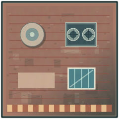

**shop-market**

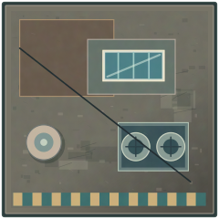

**shop-walkup**

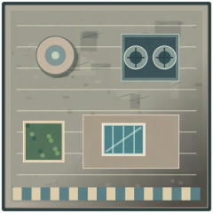

**shop-art-deco**

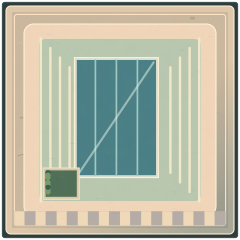

**shop-condo**

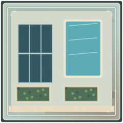

**shop-courtyard**

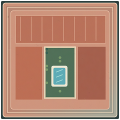

**shop-loft**

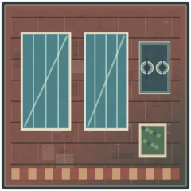

**shop-shipyard**

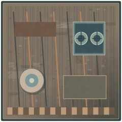

**shop-renovation**

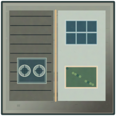

## Civic and industrial

**civic-barracks**

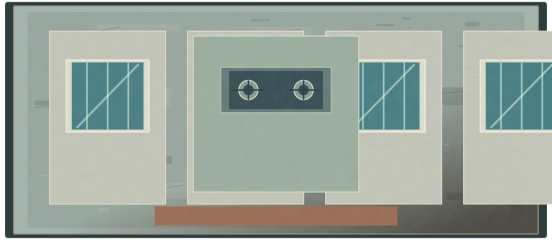

**freight-depot**

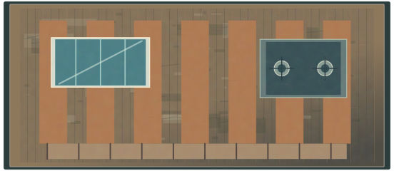

**fuel-station**

**port-office**

**bonded-warehouse**

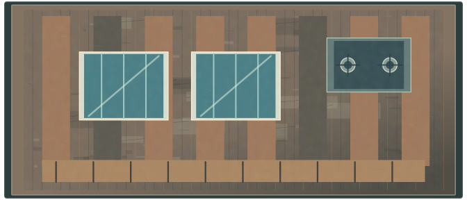

## Estates and waterfront

**villa-tile**

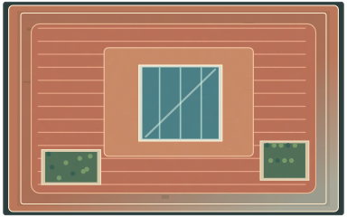

**villa-glass**

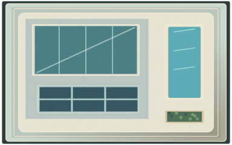

**villa-annex**

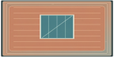

**fairway-club**

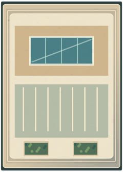

**hotel-sandpiper**

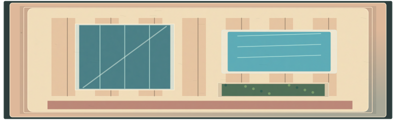

**hotel-pacific**

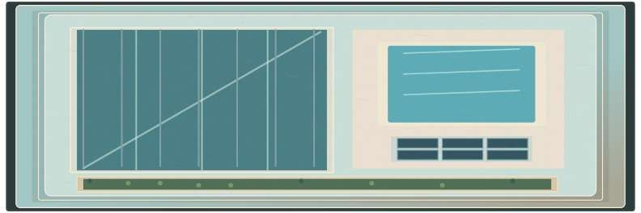

**hotel-sunset**

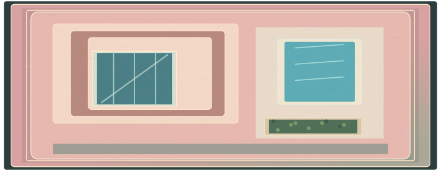
