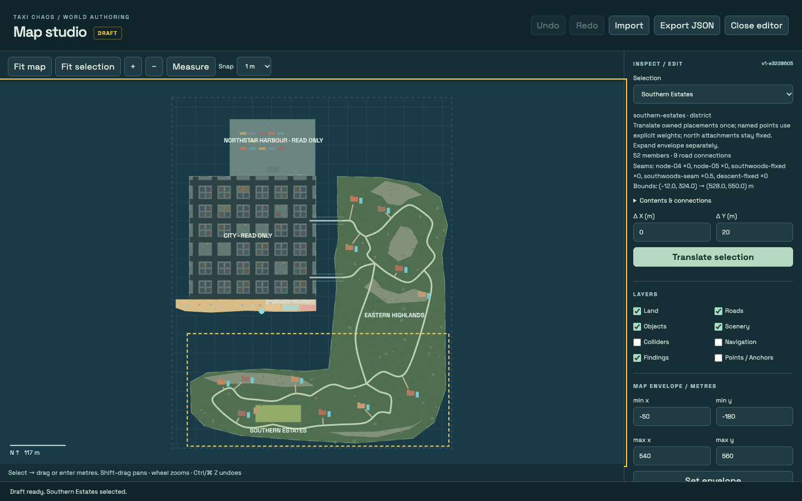
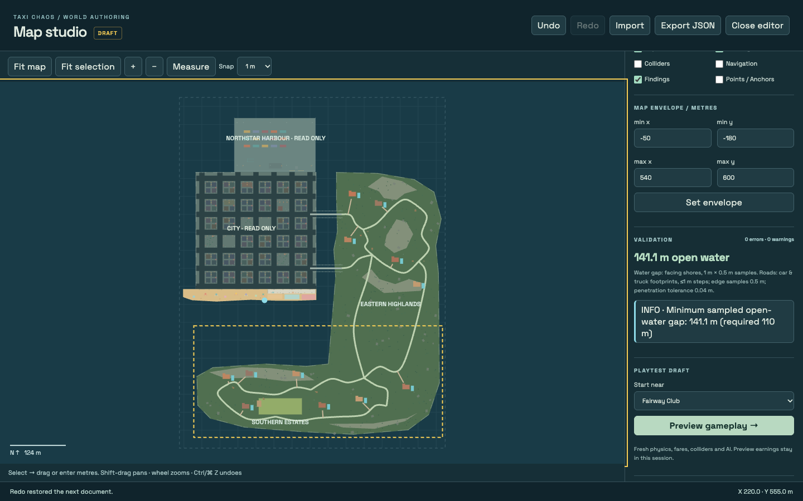
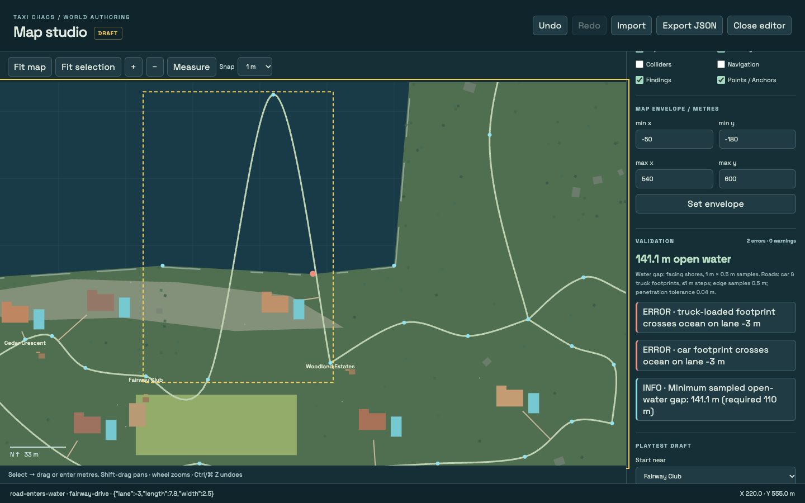
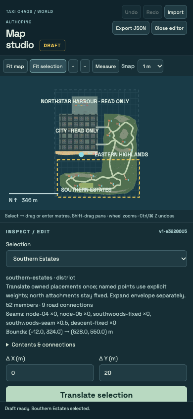
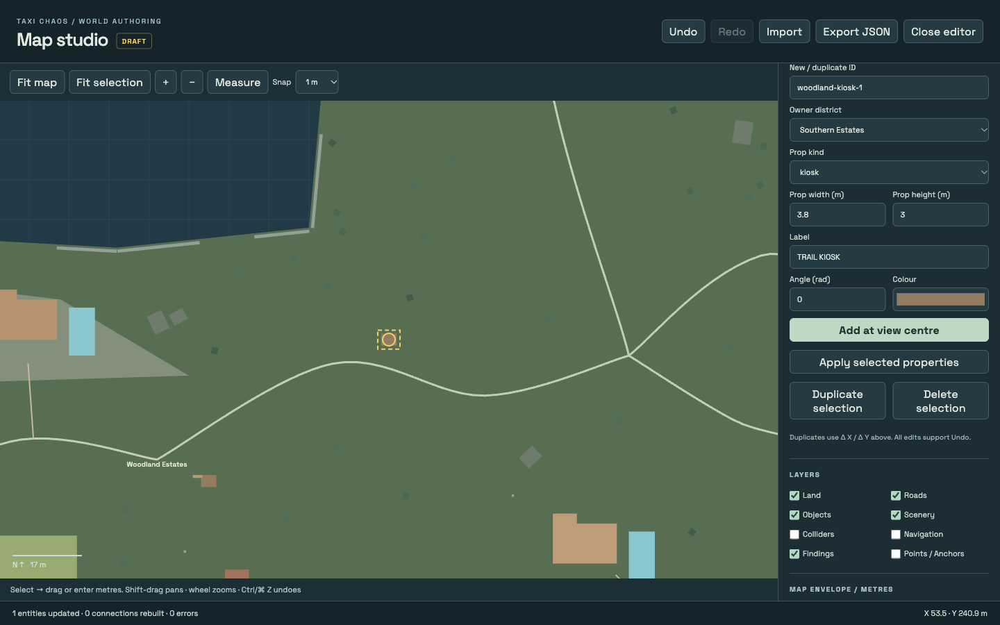
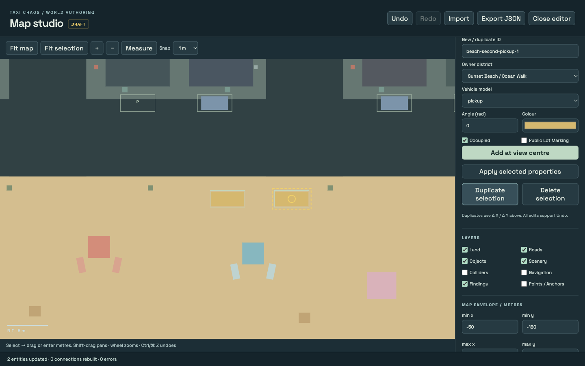
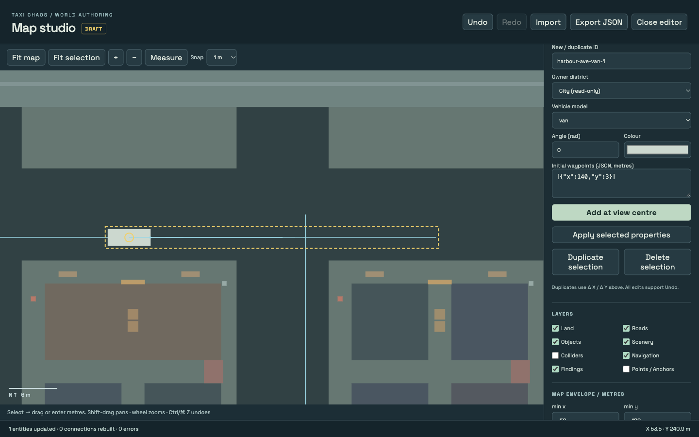

# Map studio

Taxi Chaos now has an embedded map editor: **F2 → Map studio**. On touch devices,
open the taxi menu → Test lab → Map studio. It also works offline in the single
production HTML.

## Review decisions

The critical review and amended contracts are recorded in
[`map-editor-plan.md`](map-editor-plan.md). The important decisions implemented are:

- Extract actual, already-translated coordinates into a versioned JSON document.
- Compile immutable, independent geometry per world. Physics, AI, pedestrians,
  rendering, radar, terrain, pools, dispatch and navigation read that world's map.
- Make shared points and weighted connector attachments explicit. Northern bridge
  attachments remain pinned; `southwoods-seam` moves by half the district offset.
- Keep invalid geometric drafts editable, but reject structural errors atomically
  and block gameplay preview until geometric errors are resolved.
- Retain the original Game object. Preview constructs a fresh persistence-disabled
  game, including disabled save/settings reads and migration, and discards it on return.
- Use actual collision bodies and sampled edge footprints in validation, with
  reported resolution/tolerance. Intended same-composite attachments are allowed.
- Give the envelope 10 m of southern margin beyond the old nominal 550 m extent;
  an existing rail footprint reaches 551.3 m. This changes no shipped placement.

## Human workflow

1. Open Map studio. Southern Estates is selected in the whole-map overview.
2. Use **Fit selection**, wheel zoom, or **Shift-drag / middle-drag** to pan.
3. Expand **Contents & connections** to inspect stable IDs. Choose a villa,
   destination, ridge, hotel, beach set, shoreline point or road anchor.
4. Enter **Δ X / Δ Y** and translate, or drag selected geometry on the canvas.
   Snapping applies to the displacement in metres; a completed drag is one undo.
5. For individual objects/points, use **X / Y → Set position**. Golf, hotel and
   promenade dimensions are also editable. Other composite sizes follow their
   fixed geometry catalogue; the inspector shows their generated collision sizes.
6. Turn on **Points / anchors** to select named shoreline vertices and road nodes.
   Selecting a road exposes its anchors; pinned bridge points show READ ONLY.
7. Add, duplicate, delete or re-property bounded content in **Author content**.
   Choose **Country prop**, **Parking bay** or **Traffic spawn**, set the stable ID,
   owner district and descriptor fields, then **Add at view centre**. Selecting an
   existing descriptor reuses the form; **Duplicate** uses Δ X / Δ Y and **Delete**
   removes it. Every one of these is a single undoable transaction.
8. Check findings. Clicking one fits its location and selects an affected entity.
   **Measure** takes two map clicks and reports Euclidean distance. The inspector
   separately reports the minimum sampled vertical beach-to-facing-land water gap.
9. Increase the explicit envelope when moving geometry beyond it. For the example
   extra 20 m south move, set max y to 600 m; the default is already the PR #14 map.
10. **Preview gameplay** starts a fresh cab near the chosen road stop, facing its
    first test delivery. Normal physics, AI, collisions, water and fares run.
11. **Return to editor / Esc** discards preview damage/progress and retains the
    draft/history. **Close editor / F2** restores the original game and clock.
12. Export JSON to download the draft; Import chooses a local JSON file. Import is
    undoable. Drafts remain in memory when the editor closes; export before reloading.

The city, bridges and harbour are visible read-only context. Whole-district
translation is supported for Southern Estates. Highlands and beach child geometry
is editable individually; their whole-district attachment rules are pinned.
Rotation, scaling, new districts and terrain painting are later milestones.

## Authored content collections

Three bounded descriptor collections make previously hard-coded gameplay content
first-class and editable. Each entry has a stable ID, an owner district, a
position/angle, a colour and its own strict schema and workload budget.

- **`countryProps`** — individually placed country objects (`building`, `tree`,
  `rock`, `hydrant`, `crate`, `bench`, `lamp`, `kiosk`, `bin`, `barrier`, `shed`,
  `pump`, `guardrail`, `palm`) with explicit `kind`, `width`, `height` and `label`.
  World generation instantiates each descriptor with a `sourceId` link, so it is
  selectable, movable, resizable, collidable and damageable exactly like a villa.
  Seeded woodland scenery stays procedural; props you want to own become descriptors.
- **`parking`** — every curb bay and public-lot bay, including `occupied`, `lot`,
  `model` and `colour`. The game spawns one parked vehicle per occupied bay at its
  authored position, angle, model and colour; empty bays still reserve clearance.
  Retrofitted from the previous hard-coded 74-bay layout, including the beach pickup.
- **`trafficSpawns`** — initial road vehicles with a `model`, `colour` and an
  authored `path` (initial waypoints). Density changes, off-screen wreck
  replacement and `resetRun` replenish from these descriptors; deleting all of them
  disables road-traffic replenishment rather than inventing unseen cars.

The bridge attachments and the read-only city/harbour `Props` remain generated.
Unlike those, every authored descriptor is editable and can be created or removed.
Imports from schema version 1 are migrated losslessly: the four bridge lamps become
`countryProps`, the fixed parking/traffic layout becomes explicit descriptors, and
the legacy `beach.pickup` point becomes the beach pickup bay's position. Version 2
output sorts and fingerprints the full document, so old `v1-*` revisions are stale
by design and a fresh revision must be taken.

## Agent API

Open F2 or load `?debug=1` to expose `window.__taxi`. Map operations are beneath
`__taxi.map`; the ordinary LAB API continues to address the original game.

```js
const map = __taxi.map;
map.open();
const { revision } = map.snapshot();
map.describe('southern-estates'); // bounds, members, seams, connections, policy
const result = map.apply({
  baseRevision: revision,
  operations: [
    { type: 'translate', targetId: 'southern-estates', delta: { x: 0, y: 20 } },
    { type: 'envelope', min: { x: -50, y: -180 }, max: { x: 540, y: 600 } },
  ],
});
// result: document, revision, changedIds, affectedConnections, findings
map.validate();
map.undo(); map.redo();
const json = map.export();
map.import(json);
map.select('fairway-a');
map.preview({ spawnId: 'fairway-club' });
map.step(1);                    // deterministic preview-only 120 Hz simulation
map.step(0.5, ['KeyW']);         // physics/keyboard controls; no teleport
map.previewState();             // detached gameplay snapshot
map.live();                    // restore live preview clock after scripted steps
map.edit();                    // discard preview and return to draft
map.close();                   // restore original game, camera and prior clock
```

Other operation shapes:

```js
{ type: 'move', targetId: 'villa-the-laurels', position: { x: 107, y: 414 } }
{ type: 'move', targetId: 'fairway-a', position: { x: 208, y: 446 } }
{ type: 'resize', targetId: 'golf-course', width: 96, height: 36 }
// Bounded content: descriptor is a full CountryProp, Parking or TrafficSpawn.
{ type: 'add', collection: 'countryProps', descriptor: { id: 'trail-kiosk', owner: 'southern-estates', position: { x: 300, y: 420 }, kind: 'kiosk', width: 3.8, height: 3, angle: 0, color: '#987c59', label: 'TRAIL KIOSK' } }
{ type: 'duplicate', targetId: 'parking-73', newId: 'beach-second-pickup', delta: { x: 10, y: 0 } }
{ type: 'replace', targetId: 'traffic-00', descriptor: { id: 'traffic-00', owner: 'city', position: { x: 100, y: 3 }, angle: 0, model: 'van', color: '#c9d8ce', path: [{ x: 140, y: 3 }] } }
{ type: 'delete', targetId: 'parking-00' }
```

`add`, `replace`, `duplicate` and `delete` apply to `countryProps`, `parking` and
`trafficSpawns` only. IDs must stay unique across the whole document, `replace`
must retain the stable ID, and `duplicate` moves both a traffic spawn and its
authored route. Deleting a descriptor is permanent for that draft; `undo` restores
it. A batch that would collide, leave land/water or reference a missing vehicle
rejects atomically with its history intact.

Operations use the current content revision. Unknown targets, stale revisions,
non-finite values, extra fields or structural violations reject the entire batch,
including history. Returned data is detached. Point edits immediately resample
every consuming road/ring; destination aliases move their shared node once.
The content fingerprint is an optimistic-concurrency token, not a security hash.

## Headless CLI

`npm ci` installs the existing Vite/TypeScript tooling. The CLI uses Vite's module
runner to compile exactly the browser's TS/JSON graph without a web/HMR server.

```sh
npm run map:check -- --input src/map/default-map.json --json
npm run map:check -- --input src/map/default-map.json \
  --operations docs/examples/map-move-estates.json \
  --output /tmp/taxi-map-moved.json --json
npm run map:check -- --input /tmp/taxi-map-moved.json --json
```

The example batch is based on shipped revision `v1-e3228605`; take a new revision
from the checker/snapshot after changing the baseline. Output paths must be
explicit for operation batches and **must not already exist**. This avoids
accidentally overwriting an authored map. Copy the reviewed exported JSON into the
repository using your normal editing tools.

Exit 0 means no geometric errors; exit 1 means structural/argument/file errors or
geometric findings with severity `error`. Structurally valid invalid drafts can be
exported for repair; their checker still exits 1. An intentionally invalid road
batch is in `docs/examples/map-invalid-road.json`. It reports car and 7.8 × 2.5 m
loaded-truck footprints crossing water on Fairway Drive.

For machine-readable stdout without npm's command banner, use
`node tools/map-check.mjs --input … --json`. Diagnostics go to stderr.

## Architecture and extension

| Module | Responsibility |
| --- | --- |
| `src/map/default-map.json` | Resolved authored positions, ownership, references, composites, envelope, generation and constraints |
| `src/map/schema.ts` | Strict runtime shape/reference checks for the three content collections, fixed attachments, ordered beach/entrance invariants and workload budgets |
| `src/map/compile.ts` | Detached, recursively frozen map factories and content revision |
| `src/countryside.ts`, `beach.ts`, `coast.ts` | Per-map derived roads, drives, pools, surfaces, access and rails; default adapters remain for compatibility |
| `src/world.ts` | Per-world map, bound navigation, collision hash, authored country props and descriptor parking |
| `src/map/operations.ts` | Shared atomic transactions (including add/replace/duplicate/delete), descriptions and 100-entry undo/redo history |
| `src/map/serialization.ts` | Stable sorted object keys, semantic array order, lossless numeric JSON, version-1 migration and import/export |
| `src/map/validation.ts` | Geometry, road bodies, drives, pool/solid overlap, stop reachability, walking entrances, envelope, water clearance and vehicle placement/route clearance |
| `src/map/editor*.ts`, `editor.css` | Independent overview camera, layers, selection, gestures, inspector and draft lifecycle |
| `src/map/preview.ts` | Real-game preview construction, safe road spawn and test fare |
| `tools/map-check.mjs` | Headless entry point sharing the same compiler/operations/validator |

To add editable content, define its descriptor/stable ID and owner, strict schema
checks, transactional editable fields, derived factory geometry and source-ID
links. Add it to `entities()` / descriptions and validation, and make runtime
consumers use the compiled map. Never mutate default module exports to install a
draft. A field needs the same derivation in artwork, collisions, surfaces and routes.

Adding a bounded collection (the same path `countryProps`, `parking` and
`trafficSpawns` follow) needs a strict entry shape in `schema.ts`, an
`entities()`/`describe()` inclusion and `authoredCollection()` mapping in
`operations.ts`, an `add/replace/duplicate/delete` branch there, a `descriptorBody`
for selection bounds and route sweeping, a generated `sourceId` link in the
consumer (`world.ts` / `game.ts`), and validation findings for land, overlap,
clearance, envelope and workload. Descriptors should be bounded (size, angle,
count and total route length) so an imported document cannot create an unbounded
workload.

Golf clubhouse/holes/cart route/path are local offsets from the golf centre.
Villas derive wings, pools, terraces and resident homes from their placement.
Promenade gates/bollards and local furnishings derive from its bounds. Seeded rural
candidates retain the original 530 × 550 m source lattice; translating the southern
shore carries their local region rather than re-rolling unrelated scenery. New
connector clearances can remove encroaching trees and re-sample seam rails.
City/harbour and highlands north of the seam are regression-tested unchanged.

Validation samples roads at ≤1 m, body edges at ≤0.5 m, and water gap at the
constraint's x resolution (default 1 m) and 0.5 m vertically. Penetration tolerance
is 0.04 m for solids and 0.001 m for walking entrances. These are sampled checks,
not exact continuous swept-volume proofs. The original 110 m clear-water regression
remains intact. Physical coastline flora/rails may visually straddle a shore;
authored composites are checked against their intended land.

## Verification evidence (2026-10-11)

### Authored content retrofit

- **448 tests / 31 files**, strict TypeScript and production single-HTML build.
- `src/map/content.test.ts` covers add/duplicate/replace/move/delete transactions,
  detached results and exact history restoration, atomic rejection of id/collision/
  pinned/collection errors, route movement with spawn duplication and district
  translation, strict import bounds, version-1 migration and lossless v2 round
  trips, runtime `sourceId`/model/colour/path/parking links, descriptor
  replenishment, and every new geometric finding (pool overlap, water, static,
  vehicle-vehicle, route and envelope).
- The default revision moved to `v2-abda267`; the checker still reports zero
  errors/warnings and a 121.1 m water gap. The +20 m move example is zero errors,
  141.1 m gap and 9 regenerated connections; the invalid road example exits 1.
- Offline production Chromium, 1440×900: added a country prop, parking bay and
  traffic spawn through the form, duplicated/deleted with Undo, confirmed the
  validation blocks an on-sand traffic spawn, ran a persistence-disabled preview
  (16.06 m/s at 100 HP), and migrated a version-1 document to v2 with its legacy
  pickup position retained. Editor close restored the original clock/mode.
- Only local HTML and the embedded font were requested; no external HTTP(S).

### Earlier baseline

- **432 tests / 30 files**, strict TypeScript and production single-HTML build.
- Default checker: zero errors/warnings, **121.1 m** minimum sampled water gap.
- CLI +20 m translation: zero errors/warnings, **141.1 m** gap; 9 road connections
  regenerated. Invalid road fixture exits 1 with structured body-footprint findings.
- Normal `npm test` caps workers at 2 to avoid concurrent simulation contention;
  the freight test retains its full five-minute simulation and explicit 20 s budget.
- Offline production Chromium, 1440 × 900: F2 entry, numeric/drag equivalence,
  one undo per gesture, point dragging, object numeric editing, stale rejection,
  finding navigation, preview blocking, canonical export and file import.
- Physical relocated Fairway Club → Woodland Estates delivery: **16.6 simulated
  seconds, 100 HP, $241 payout**, no mid-drive teleports or upgrades. The ordinary
  original-game snapshot and browser save keys were unchanged through preview,
  pause/resume, return and close; original fixed clock was restored exactly.
- 390 × 844: touch menu entry, readable scrolling inspector, actual local CLI JSON
  upload, undo/redo import and measurement (120.00 m), no horizontal overflow.
- Import/undo/redo safely restores selection when an imported entity ID disappears;
  production preview still picks up its fare at 100 HP after the final review fixes.
- Relocated pool and beach surf drowning use actual gameplay water rules in tests.
- No console errors/warnings; requests were local HTML and embedded font only.









