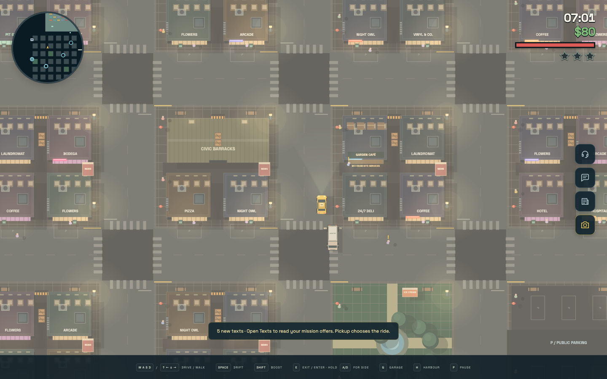
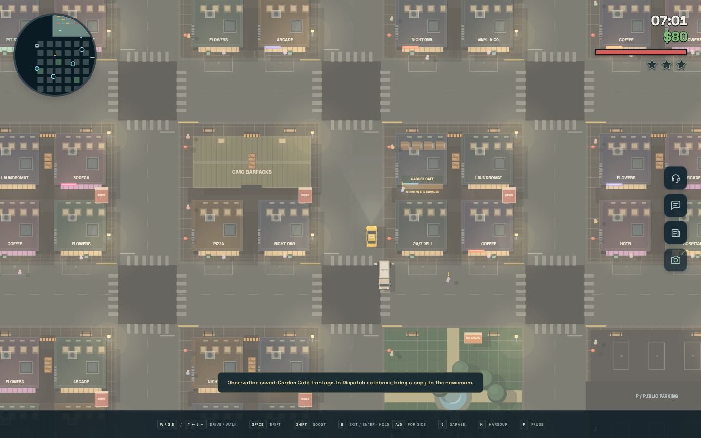
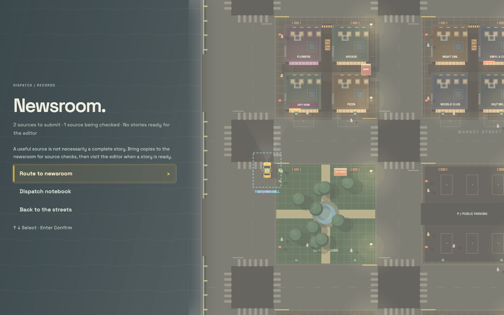
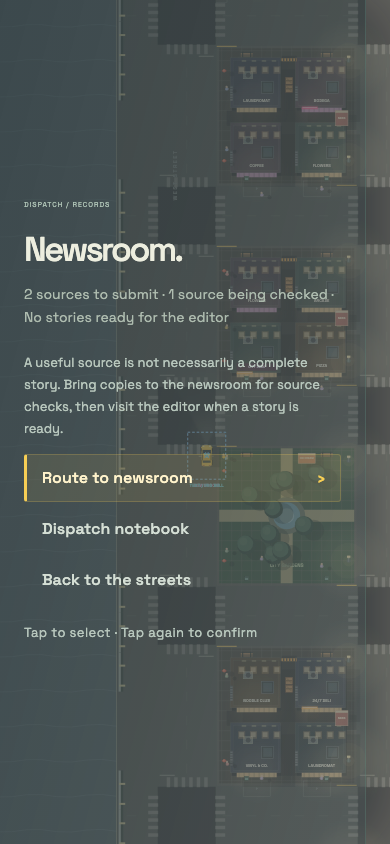
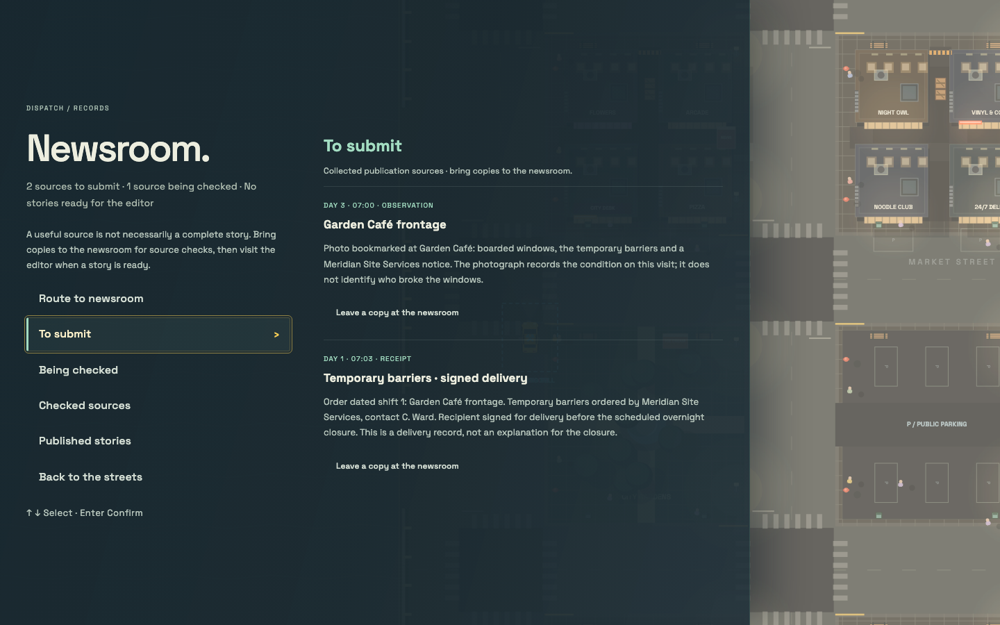
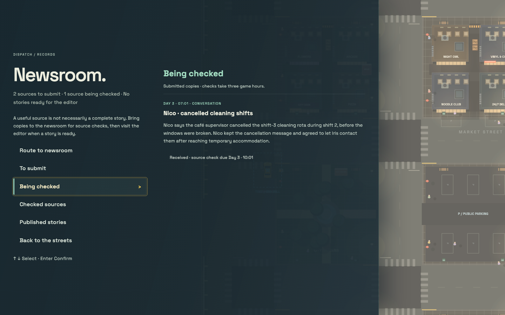

# Newsroom interactions and observation gathering

## Goal and scope

Make it clear what the player has collected, what can be left at the newsroom,
and whether a story is ready for editorial review. A useful source is not
necessarily a publishable story.

Keep deliberate observation collection, physical newsroom visits, the
three-game-hour source checks, independent corroboration, editorial approval,
edition timing and campaign deadlines. Do not add truth percentages, reveal
undiscovered sources as a checklist, or change the wider input/binding system.

## 1. Restore deliberate observation gathering

- Add an observation/camera icon to the existing quick-action panel, outside the
  minimap. Show it near an authored observation site whose scene is eligible.
- Use the same authored location, radius, speed, mode and campaign predicates
  for the button and the collection command. Follow the active actor on foot
  as well as in a vehicle; opening the UI must never collect automatically.
- Explain when the player must slow down. An available action is visually
  highlighted and has an accessible name describing the scene.
- Confirm collection with the observation title and where to find it in the
  Dispatch notebook. Explain that a copy can be brought to the newsroom, not
  that the observation alone makes a story publishable.
- Once collected, show a checked, disabled “Already recorded” state near the
  site. Repeated collection must not create extra records or success notices.
- Keep the icon usable with mouse, keyboard focus/activation and touch. Preserve
  safe areas, minimum 44 px targets and the other quick actions on small screens.

Implemented as the first slice: the camera appears near eligible scenes, highlights
when recordable and keeps a checked state once saved. The other quick actions and
newsroom routing retain their existing behaviour in that slice.

## 2. Give newsroom records a direct entry point

Make the existing newsroom icon open a Newsroom panel instead of only toggling
guidance. Keep “Route to newsroom” inside that panel. Show a concise summary:

> 2 sources to submit · 1 source being checked · No stories ready for the editor

The panel must be accessible directly from the HUD without finding the pause
notebook. Do not implement this replacement as part of observation gathering.

Implemented as the second slice: the HUD newsroom icon opens a single-column
page in the shared pause drawer. It reuses the existing menu rows, scrolling,
keyboard/controller navigation, touch select/confirm and responsive styling;
opening the page pauses play without changing guidance or collecting records.
Routing is an explicit action inside the panel. The existing Dispatch notebook
is one action away and returns to the newsroom when opened from there.

The summary counts discovered sources used by authored publication routes,
pending source checks and stories that pass the actual editorial-approval
predicate. General records do not inflate the source count; checked material,
blocked dependencies and scheduled/published stories do not inflate readiness.
After the final edition, unsubmitted records remain visible without promising
that they can still be submitted. Submission, verification and publication
rules are unchanged. This single-column entry was the starting point for step 3;
the current menu/detail layout below supersedes its notebook shortcut.

## 3. Separate useful sources from general notes

Organize the panel into:

| Section | Meaning |
| --- | --- |
| To submit | Collected sources not yet left at the newsroom |
| Being checked | Submitted sources, with the actual completion time |
| Checked sources | Verified material, not necessarily a complete story |
| Stories | Editorial readiness, scheduled editions and published stories |

Not every authored material contributes to a publication route. Keep those
records in the ordinary pause notebook, without advertising them as evidence
for a publishable story in the Newsroom panel.

Implemented as the third slice, with the clarified menu/detail layout:

- The first desktop column contains Route to newsroom, To submit, Being checked,
  Checked sources, Published stories and Back to the streets. Activating a section
  fills the second column; focus, hover and directional selection alone do not.
- The panel has no Other notes section or Dispatch notebook link. General
  conversations, ordinary fare history and authored non-publication material stay
  in the ordinary pause notebook and do not appear in publication-source lists.
- Source lists reuse the notebook's record widgets, retain originals, show actual
  completion times and move checked material separately from admitted stories.
  The story pane retains authoritative editorial readiness, scheduled editions
  and published editions, without exposing incomplete routes or future material.
- Mobile uses the same menu and selected detail in a single-column flow, with a
  Back to newsroom menu action. All actions retain the existing physical-visit,
  source-check, editorial-approval, dependency and deadline rules.
- Detailed explanations for incomplete stories remain step 4.

## 4. Explain each story's next step

For stories connected to discovered material, derive plain-language status from
the authoritative campaign state and conditions:

- More corroboration needed.
- Sources collected — bring them to the newsroom.
- Source checks underway — ready Day 5, 10:30.
- Ready for editorial review — visit Ruth.
- Waiting for another story's editorial approval.
- Scheduled — Day 6, 06:00 edition.
- Published.
- Publication deadline passed.

Handle verification, approval and publication dependencies separately. Do not
label an incomplete source collection as a ready story, or expose future
missions and documents that the player has not discovered.

## 5. Make the physical newsroom visit obvious

When stopped nearby, offer “Visit newsroom”. Put actionable work first:

- Submit collected sources with a clear confirmation.
- Request publication of ready stories.
- Explain disabled actions instead of only greying them out.

Give one-time feedback for meaningful transitions: source collected, checks
complete, story ready and story published. Keep records after submission.

## Verification

- Unit-test observation availability and collection against the same rules,
  duplicate handling, on-foot visits, source retention and save reconstruction.
- Cover multiple authored observations without assuming the first is nearby.
- Browser-check real icon activation, checked state, notebook entry and rejected
  stale actions in isolated, persistence-disabled scenarios.
- Check 1440×900 desktop first, then compact portrait and landscape layouts,
  touch activation, keyboard activation, safe areas and HUD overlap.
- Run appropriate tests, strict TypeScript checking and the production build;
  exercise the self-contained HTML offline without runtime network requests.
- Later slices should cover every editorial state, dependency, deadline and
  the physical submit → verify → request → edition flow without changing rules.

### Observation slice checks

- `npm test -- --testTimeout=30000` gives long physical simulations an appropriate
  per-test budget without shortening their driving sequences.
- `npm run build` includes strict TypeScript checking.
- `node tools/observations-check.mjs` checks the standalone game offline across
  eight desktop/touch layouts, physical approach and speed gating, native keyboard
  and touch activation, duplicate/stale clicks, notebook visibility, save
  reconstruction, on-foot state, minimum target sizes and asymmetric safe areas.
- `node tools/navigation-hud-check.mjs` retains the existing navigation and
  physical driving/riding regression checks in isolated offline browser contexts.

Screenshots from the actual quick-action flow:

| Ready to record | Recorded |
| --- | --- |
|  |  |

[Portrait touch](screenshots/observations/portrait-recorded.png) ·
[Compact landscape touch](screenshots/observations/landscape-480-recorded.png)

### Newsroom entry slice checks

- `src/campaign/newsroom-view.test.ts` covers discovered-source counts, general
  records, deduplication, check completion, incomplete routes, approval versus
  publication dependencies, scheduled/published stories, deadlines, independent
  authored claims and entry-aware notebook back navigation.
- `node tools/newsroom-check.mjs` checks the standalone HTML offline in six
  desktop/touch layouts: native HUD entry, accurate summaries, explicit routing,
  unchanged records/bookings, keyboard focus/activation, touch confirmation,
  notebook/guide back navigation, reachable 44 px controls, asymmetric safe
  areas, save reconstruction and on-foot entry. A separate realtime fixture
  verifies paused physics/clocks, controller navigation and realtime restoration.
- `SCREENSHOT_DIR=scenario-runs/start-pause node tools/splash-check.mjs` checks
  the reused drawer, touch controls and controller behavior. The navigation and
  observation checks above retain physical driving/riding integration coverage.
- `npm test -- --testTimeout=30000`: 59 files / 741 tests passed.
- `npm run build`: strict TypeScript and standalone production build passed.
- All browser checks completed without console errors or external runtime requests.

Screenshots from the actual HUD entry:

| Desktop summary | Portrait touch |
| --- | --- |
|  |  |

[Story ready for the editor](screenshots/newsroom/desktop-ready.png)

### Source separation / menu-detail slice checks

- `src/campaign/newsroom-view.test.ts` covers activation-dependent markup,
  route-membership classification, deduplication, non-publication exclusion,
  retained copies, exact check boundaries, editorial dependencies and deadlines.
- `node tools/newsroom-check.mjs` checks the standalone HTML offline in six
  desktop/touch layouts: left-menu/right-detail geometry, mobile stacking,
  explicit activation versus mere selection, actual completion times, physical
  submission restrictions, submit → check → request → edition, save reload,
  source retention, keyboard wrapping, touch confirmation, controller activation,
  44 px controls, safe areas, paused clocks and realtime restoration.
- `SCREENSHOT_DIR=scenario-runs/start-pause node tools/splash-check.mjs`,
  `node tools/navigation-hud-check.mjs` and `node tools/observations-check.mjs`
  retain shared-drawer and physical desktop/touch driving/riding coverage.
- `npm test -- --testTimeout=30000`: 59 files / 743 tests passed.
- `npm run build`: strict TypeScript and standalone production build passed.
- Browser checks completed without console errors or external runtime requests.

| Desktop: menu and selected sources | Desktop: source check completion time |
| --- | --- |
|  |  |

[Editorial readiness](screenshots/newsroom-sections/desktop-ready.png) ·
[Published edition](screenshots/newsroom-sections/desktop-published.png) ·
[Portrait source check](screenshots/newsroom-sections/portrait-checking.png) ·
[Compact landscape source check](screenshots/newsroom-sections/landscape-480-checking.png)
