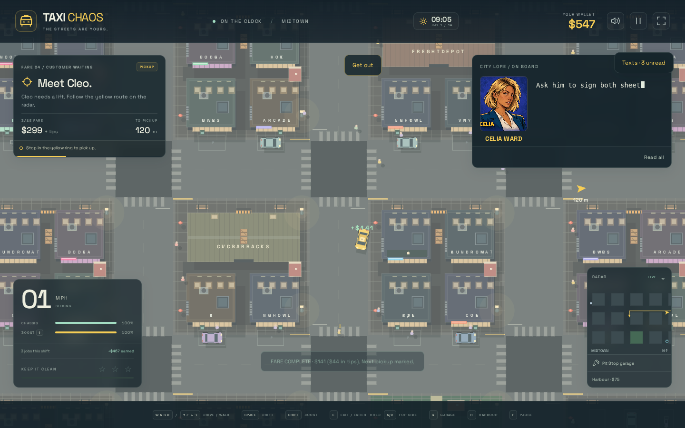
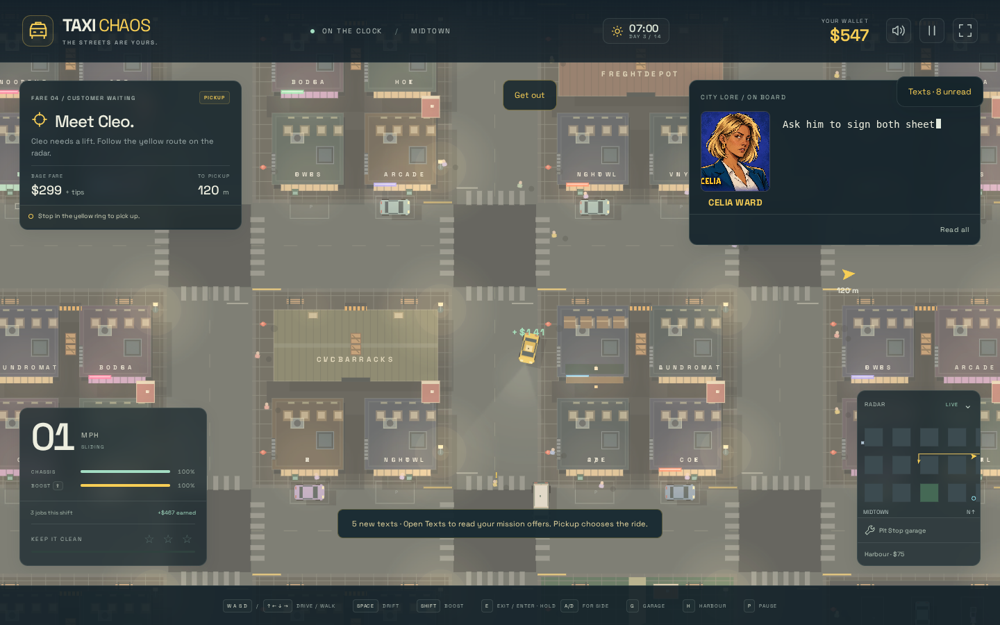

# Open Shore: a campaign that advances while you drive

The taxi business gives the player a view of a fixed election scandal. Driving
ordinary fares remains a complete way to play; investigating is optional.
This revision implements the first world-driven thread from PR #23, replacing
the manual-shift and automatic-publication shortcuts in the initial PR #25.

## Playing

- **Time advances while driving:** one simulated second is one game minute.
  The HUD shows the working day out of fourteen and HH:MM. A working day starts
  at 07:00 and includes the following night. The campaign starts on calendar
  Day 1 at 07:00 and finishes on Day 15 at 07:00, after fourteen full days.
  Pause, garage menus, hospital recovery and reloading do not advance it.
- **Normal dispatch alternates ordinary and eligible local authored fares.**
  After an ordinary delivery, it suggests a recurring customer's booking,
  prioritising the earliest deadline and then distance. Texts still lets you
  choose another job. Pause → **Ask dispatch for an ordinary fare** skips a
  suggestion. The two competing transport pairs require an explicit text-route
  selection, so automatic dispatch cannot choose a consequential branch.
- **Conversations unfold during rides:** pickup, a further exchange after at
  least eight seconds and ten metres of travel, then an arrival line. Departure
  dialogue carries across the next dispatch. Lines enter the notebook when
  offered visibly/accessibly or fully revealed; unpresented beats grant nothing.
  Ordinary customers also comment on visible café changes and public responses.
- **Sleep at Pit Stop:** park safely, finish or explicitly abandon an aboard
  fare, then pause and choose **Sleep at Pit Stop**. The menu previews the next
  07:00, hours skipped and known bookings that close. Sleep is unavailable during
  a chase, fire, nearby pending blast or an unread expanded conversation.
  It advances events without running physics, resetting the city, repairing the
  car, changing cash or carrying a passenger overnight.
- **Texts** shows named physical pickups and exact **pickup-before** deadlines.
  Availability is half-open: a booking expires as its deadline begins. An
  accepted passenger can still be delivered after the pickup deadline.
- **Taxi menu → Dispatch notebook** retains conversations, signed receipts,
  documents and deliberately bookmarked observations. Search revisits the
  wording. New records retain campaign time and source provenance.
- Stop near the boarded **Garden Café** and select **Bookmark café frontage**.
  Seeing a changed frontage does not automatically add a photograph or explain
  who caused it. World happenings never write player records.
- Visit **Old Town South** and open the notebook to leave chosen copies at the
  newsroom. Originals remain. Each received source takes **three game hours**
  to check. Independent supported material produces a ready editorial case,
  without publishing it.
- Return to the editor and choose **Ask Ruth to run this story**. Accepted
  stories appear in the next **06:00 edition**. Institutional responses follow
  **two game hours after publication**. The last edition is **Day 14 at 06:00**;
  source checking and the editorial visit must happen before that edition.
- The campaign concludes before an election result. Fares already aboard may
  finish, then ordinary free driving continues. Recovery and Lab run reset
  preserve narrative time; only an explicit new-campaign reset clears it.

## The Garden Café thread

These are author-facing facts, not a player checklist:

| Calendar time | World operation | Potential discovery |
| --- | --- | --- |
| Day 2, 21:00 | Waterfront cover withdrawn | Lena's transport docket and later original order |
| Day 2, 22:00 | Contractor van MS-14 arrives; security contract begins | A real parked van with readable fleet lettering at the café |
| Day 2, 23:00 | Windows broken | Broken glazing on the existing café building |
| Day 3, 07:00 | Frontage boarded | Persistent boards and contractor notice; optional bookmarked observation |
| Day 3, 12:00 | Van departs; cover returns | Existing van rejoins physical traffic rather than disappearing |
| Day 5, 10:00 | Tenancy hearing | Closure or tenancy review, depending on whether Iris reached the tenant beforehand |
| A requested 06:00 edition | Verified café material published | Changed local coverage; the contract initially remains |
| Two hours later | Security contract suspended | Café notice changes to CONTRACT SUSPENDED; ordinary riders react |

Every operation has a stable ID, timestamp and recorded outcome. The same
operations resolve in chronological order during sleep or active play. A later
visit cannot change the outcome of an already held hearing. Missing Nico's
interview can be recovered through Eli's original job card and Tom's filed
purchase register. The café still changes when neither source is encountered.

## Cast, branches and corroboration

The recurring cast remains Mara Velez, Eli Price, Victor Saye, Celia Ward,
Adrian Vale, Leila Grant, Captain Frank Harker, Officer Lena Ortiz, Iris Bell,
Tom Keene, Ruth Okafor and Bea Santos. There are 24 paid authored bookings, now
with additional travel/arrival exchanges, and five everyday job families.
Bea's radio repair remains a small independent story.

Nico's accommodation ride competes with Celia's replacement-roster booking;
Leila's newsroom departure competes with Celia's return booking. Routing is
reversible, actual pickup commits the branch, and safe arrival grants completion
effects. A lost waiting contact remains lost through reload and recovery.

| Allegation | One route | Independent alternative |
| --- | --- | --- |
| Coordinated disorder | Barrier receipt, Nico's cancellation account, café observation | Eli's original docket and contractor register |
| Withdrawn police cover | Lena's original order and transport docket | Dispatch carbon copies and traders' complaint log |
| Vale's informed protection | Leila's warning and council authorisation | Committee-clerk account and contract carbon |

The political story also needs the café and policing reporting. Each case has
separate verified, editorial-request and publication times. Publication does
not immediately cancel an appearance or launch an inquiry: those are separately
recorded responses. No combined investigation score or deduction checklist is
shown. Author facts do not become player knowledge merely by occurring.

## Implementation and persistence

| File | Responsibility |
| --- | --- |
| `src/campaign/clock.ts` | Absolute calendar, dawn boundaries, precise last edition and finale |
| `src/campaign/events.ts` | Typed persistent world state and immutable authored operations |
| `src/campaign/scheduler.ts` | Bounded chronological world, authentication, edition and response resolution |
| `src/campaign/state.ts` | Validated v2 snapshot, legacy-shift migration and accepted story-ride resume |
| `src/campaign/content.ts` | Bookings, exact pickup windows, material and independent corroboration |
| `src/campaign/ride-dialogue.ts` | Authored travel/arrival exchanges and ordinary riders' local reactions |
| `src/campaign/bulletin.ts` | Public coverage and later response selectors |
| `src/campaign/view.ts` | Notebook, source status, physical submission and editorial requests |
| `src/game.ts` | Playing clock, safe sleep, shared-map van projection, dispatch and physical gameplay hooks |

All mutually dependent narrative, record, mission and economy changes share one
localStorage save envelope. Authored rides aboard at save time resume without
replaying choice effects; their transient vehicle restarts parked at the pickup.
Career cash, deliveries, old notebook entries, text history and prior publications
survive migration. A manual-shift save maps its shift to 07:00 of that working
day; no historical evidence is invented.

Lighting follows the campaign normally. Lab sky presets override lighting only.
Opening Test Lab creates a persistence-disabled copy; campaign advance controls
operate on that copy. **Return to saved game** restores the original instance
and its camera/clock. Collapsing the Lab panel keeps the temporary game active.
Map previews remain fresh and narrative-free.

This is one implemented world thread and a reusable scheduler, not a complete
simulation of every character's home/work routine or every police/security
operation. Source checks use authored independent records and a fixed delay;
there is no freeform editor interview system. Other cast bookings share the
calendar and editorial workflow. The supplied portraits and offline asset
embedding are retained.

## Verification

Automated coverage includes continuous time, safe sleep, identical awake/skipped
outcomes, exact deadlines, irreversible hearing outcomes, mixed dispatch,
movement-gated conversation, source loss, accepted-ride reload, independent
source checks, explicit editorial requests, ordered editions, delayed responses,
cutoff, old saves and isolated previews. The full automated suite passed 592 tests; the final campaign suite passed
26 tests, including two additional regressions for skipping dispatch and legacy
publication reloads. Strict TypeScript, the standalone production build and
`git diff --check` pass. A partial browser smoke check physically delivered
Bea’s opening fare, an ordinary fare, Celia’s barriers and Nico’s accommodation
ride, then bookmarked the boarded café. The automatic driving controller
stalled at a building corner on the newsroom route, so that browser attempt
was stopped; full browser investigation and layout checks are not claimed.

## Manual reproduction

1. Complete Bea’s opening job, then the ordinary fare. Dispatch should suggest
   Celia’s **Temporary barriers** booking. Complete it and check the signed
   barrier receipt in the notebook. Watch for additional dialogue after moving
   at least ten metres and driving for eight seconds, plus an arrival line.
2. Park at Pit Stop and sleep until Day 2, then Day 3. The sleep menu previews
   closing bookings; your cash, vehicle health and simulation time stay put.
   Alternatively, in Test Lab use **Campaign time → Day 3 → Advance to 07:00**;
   this operates on a temporary copy. Sky presets must not change campaign time.
3. Visit Garden Café. Its windows are boarded and the Meridian notice is up.
   Bookmark the frontage. Choose Nico’s **A temporary address** booking in Texts
   and deliver them; this retains their cancellation account.
4. Visit Old Town South. Open the notebook and leave copies of the barrier
   receipt, Nico’s account and the café photo. No publication should appear.
5. Let three game hours pass (three real minutes of active play), or explicitly
   advance the temporary Lab campaign by three hours. The source checks become
   complete and a café story becomes ready, with no automatic publication.
6. At the newsroom, ask Ruth to run that story. At the next 06:00 edition the
   coverage changes, while Meridian’s contract remains. Two game hours later,
   revisit the café: the notice reads **CONTRACT SUSPENDED**.
7. Reload during an authored ride: the same aboard mission resumes parked at
   its pickup, without replaying its branch choice. To test missed events, start
   a fresh temporary campaign and advance straight to Day 7: the café and hearing
   have resolved, but no photo, source submission or article has been granted.

