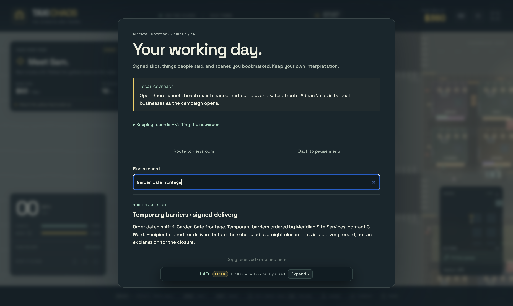
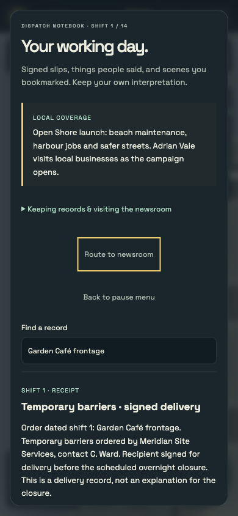
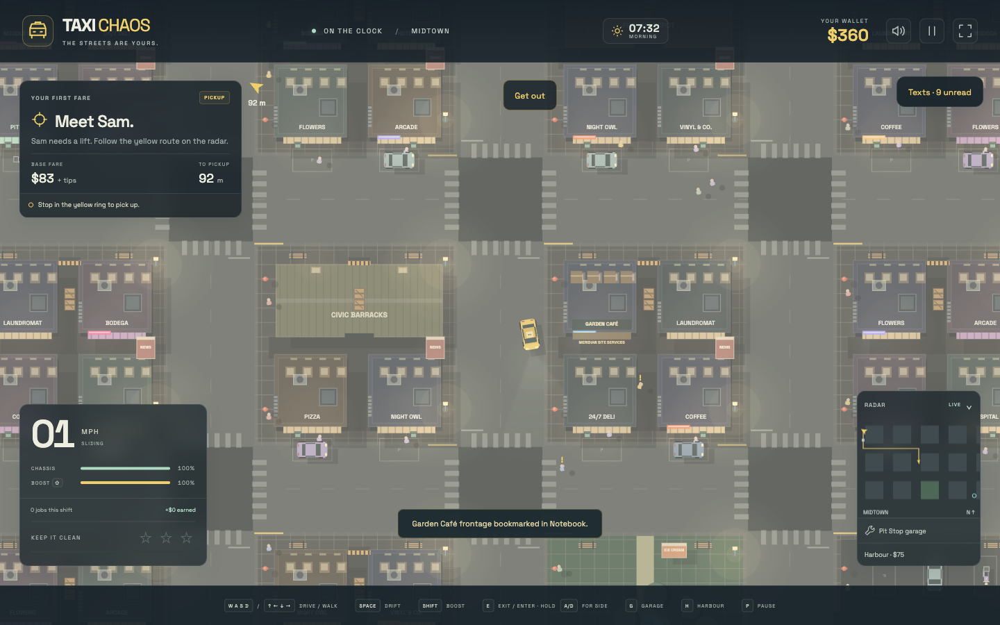

# Open Shore: first playable narrative build

The taxi business is the player's view of an election campaign. The conspiracy
has fixed facts, but investigating it is optional. A driver can work ordinary
fares for all fourteen shifts, end on polling day, and continue free driving.

## Playing

- **Pause → End shift** advances the campaign by one shift. Finish or explicitly
  abandon an aboard fare first. Recovery, reloading and Lab run resets preserve
  the campaign date. The world lighting clock is a separate clock.
- **Texts** contains dated bookings with named physical pickups. Routing does
  not accept a booking. Competing bookings commit on the stopped pickup.
- **Taxi menu → Dispatch notebook** pauses driving and retains authored dialogue,
  signed receipts, documents and bookmarked observations. Search revisits names,
  addresses and wording. Nothing connects the clues for the player.
- Stop near **Garden Café** from shift 3 and choose **Bookmark café frontage**
  to retain a dated observation of its boarded windows and site-services notice.
- Route to the **newsroom at Old Town South**, stop nearby, and open the notebook
  to choose individual material to leave. Originals remain in the notebook.
  Visiting the newsroom does not accept a co-located fare.
- Newsroom receipt is distinct from publication. Independent authored material
  is reviewed on the next shift. Shift 13 is the last submission date for
  election-day coverage. A lone receipt or repeated rumour does not publish a
  scandal. The UI shows actual local coverage, not an evidence meter.

## Cast and working life

The recurring campaign cast is Mara Velez, Eli Price, Victor Saye, Celia Ward,
Adrian Vale, Leila Grant, Captain Frank Harker, Officer Lena Ortiz, Iris Bell,
Tom Keene, Ruth Okafor and Bea Santos. Their introductions are practical rides:
parts, uniforms, interviews, printer proofs, forgotten leaflets and hotel work.
Bea's radio repair resolves independently of the political story.

The catalogue contains 24 paid authored bookings, including the two competing
transport pairs and the optional election-day ride. Their windows avoid putting
the same recurring passenger at multiple waiting stops at once. They span the
city, working docks, beach, hotels, Woodland Estates and Fairway Club.

After the opening job, automatic dispatch supplies ordinary work. Five small
job families give Sam, June, Ravi, Cleo and Oscar persisted dialogue continuity
based on their own delivered rides. A birthday cake remains an ordinary job.
Authored text bookings are available to a driver who deliberately pursues them;
no numerical 70/20/10 quota restricts that choice.

## Designer facts and corroboration

These are **author-facing spoilers**, not a player checklist. Meridian supplies
the campaign and prepares closures before the damage; Harker selectively
withdraws cover; Vale acknowledges a warning on shift 8 and protects Meridian's
arrangement in his shift-9 authorisation. Breakwater's traders log can be true
while Mara's motives remain coercive. A meeting photograph alone proves none of
the political allegation.

Each allegation has two disjoint authored routes:

| Allegation | One route | Independent alternative |
| --- | --- | --- |
| Coordinated disorder | Barrier receipt, Nico's retained cancellation account, café observation | Eli's original repair docket and the filed contractor register |
| Withdrawn police cover | Lena's original order and the completed station transport docket | Dispatch carbon copies and traders' timed complaint log |
| Vale's informed protection | Leila's briefing acknowledgement and council authorisation | Certified committee-clerk account and retained contract carbon |

The political connection reaches public coverage only after the coordinated
disorder and policing allegations can also be substantiated. Smaller stories
can publish independently. There is no combined investigation score.

Nico's accommodation ride competes with Celia's replacement-roster booking;
Leila's newsroom departure competes with Celia's return booking. The messages
explain the transport tradeoff before pickup. Safety and delivery effects wait
for arrival, while the selected branch survives abandonment. Iris reaching the
tenant interview keeps the café tenancy under review independently of exposure.

A lost waiting source is recorded permanently, closes their later bookings,
and retains their received texts. No identical source is resurrected on the next
checkpoint or reload. Alternative records give each allegation another route.
The underlying vehicle/recovery system still supports emergency exits and
retryable interrupted rides.

Polling-day presentation reflects public coverage and the tenancy intervention.
Campaign appearances can be cancelled, smaller inquiries can open, or Vale can
remain the favourite while a local business has secured a hearing. Bea's voting
fare is optional. The campaign finishes before an election result.

## Implementation

| File | Responsibility |
| --- | --- |
| `src/campaign/content.ts` | Frozen, typed authored jobs, dialogue, fixed records, corroboration bundles, regulars and public coverage |
| `src/campaign/state.ts` | Versioned shift calendar, received submissions, dated publications and regular-ride counts |
| `src/campaign/view.ts` | Searchable notebook and individual submission actions |
| `src/player-records.ts` | Separate bounded player knowledge, receipt and notebook migration |
| `src/missions/schema.ts` | Bounded `shiftAtLeast` / `shiftAtMost` prerequisites |
| `src/missions/compile.ts` | Shared map/character/route validation of the Open Shore catalogue |
| `src/game.ts` | Physical collection, document receipt, local observations, newsroom routing and explicit shift end |
| `src/renderer.ts` | Changed frontages and campaign signs drawn on existing map bodies |

`Game` defaults to Open Shore. `new Game(map, false)` creates a fresh isolated
campaign. `new Game(map, false, false)` keeps map previews narrative-free.
`new Game(map, persistence, 'legacy')` retains the original Mia/Frankie catalogue
for the engine's regression fixtures. Existing saved economy, outcomes and text
history are retained; saves without a campaign start at shift 1 without invented
historical records. Only explicit story reset clears the campaign and notebook.

The initial build uses textual scene bookmarks and authored next-shift newsroom
review. Regulars currently have dialogue continuity rather than fully simulated
home/work routines. Scheduled city changes are frontage notices, boarded windows
and public coverage; richer patrol schedules, security operations and editorial
case handling can build on these separate state domains.

The supplied Bea, Celia and Vale PNG portraits are used directly. Nine other
campaign identities have original provisional SVG portraits with initials.
The portrait manifest also retains supplied legacy PNG assets and is checked
against the actual folder. All art and sound remain embedded in one HTML file.

## Verification

- `npm test`: **42 files, 585 tests passing**. Campaign coverage includes
  expiry/history, contact loss, unique waiting identities, physical choice
  boundaries, deliberately acquired observations, newsroom location checks,
  independent corroboration, delayed publication, uninvolved completion,
  migration, reset and preview isolation.
- `npm run build`: strict TypeScript and the single-file production build pass.
- Isolated production `file://` browser with networking disabled: no external
  runtime requests; clean console after reload.
- Physical stock-cab driving through the opening pickups, deliveries and a
  newsroom visit; receipt submission retained the original without publishing.
  A later physical visit bookmarked the changed café in shift 3. No mid-drive
  teleports or upgrades.
- Desktop 1440×900, portrait 390×844 and 320×568, landscape 844×390: notebook
  remains within the viewport, scrolls vertically and has 44px action buttons.
- Actual pause-menu shift advancement checked with the fixed-step Lab active;
  realtime is restored after automation.

