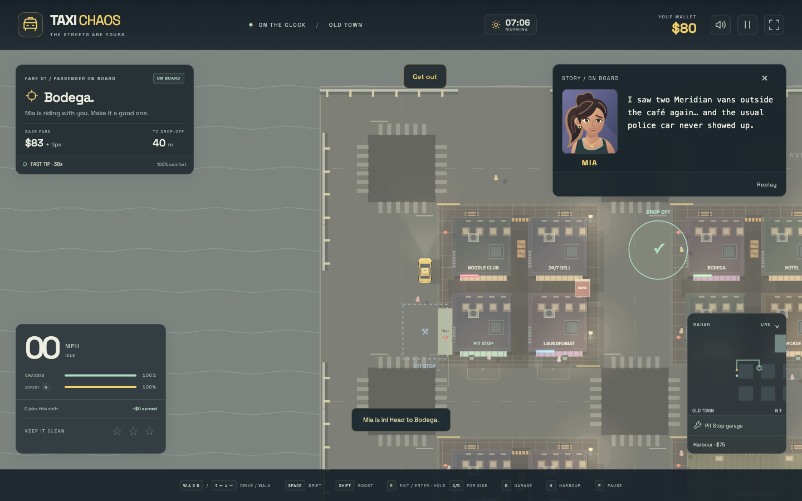
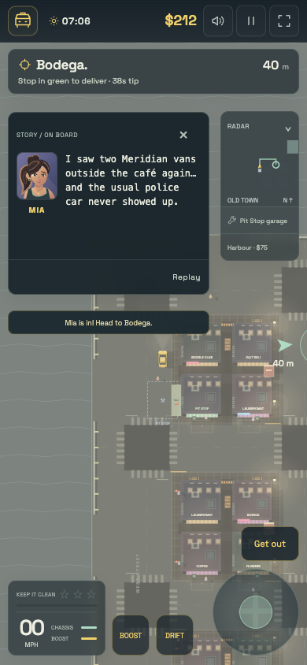
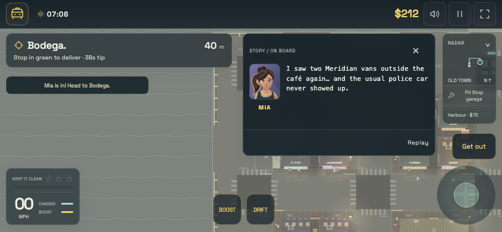
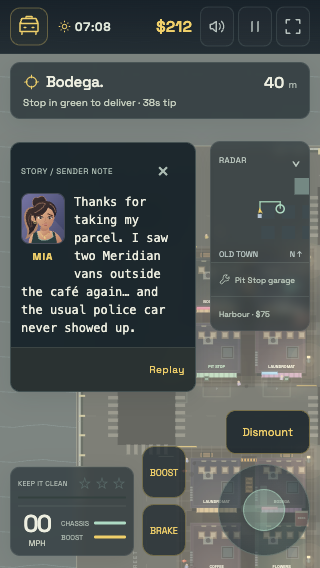

# Pickup dialogue / first story mission

Picking up **Mia on the first fare** opens a portrait dialogue in the top-right
corner. She mentions two **Meridian vans** outside the café and a missing police
car: the opening plot hook. Taking a courier bike before that pickup instead
shows Mia's **sender note** when her parcel is loaded.

Text types out while you drive; **Read all** reveals it immediately, **Replay**
starts it again, and **×** minimizes it to a replay button. It stays available
until the delivery ends or is abandoned. Pausing freezes the text as well as the
game. Reduced-motion users see the full message immediately; screen readers
receive the whole message once rather than individual letters. Touch layouts
keep the radar and driving controls accessible. Emergency instructions take
priority over dialogue.

## Authoring

The opening mission and its dialogue are now authored content in
[`src/missions/catalogue.json`](missions.md): a **plot** mission
(`mia-meridian-lead`) with a passenger beat (`mia-meridian-vans`) and a sender
variant (`mia-meridian-parcel`) that plays when the pickup becomes a parcel
run. A message names its **speaker** with a stable character ID; the display
name and portrait are resolved from the character catalogue at render time.
Recurring names such as Mia are not treated as story identifiers.

Characters live in `src/characters.json` with an immutable `id`, display `name`,
portrait metadata and attribution. Portrait files live in
`src/assets/characters/` and are discovered at build time by the eager
`import.meta.glob` registry in `src/portraits.ts`, which supports **SVG**,
**PNG** and **JPEG** side by side. The DOM-free `src/portrait-manifest.ts` holds
the declared file names so character and mission validation never import the
image registry. Every file is imported with `?inline`, so it is embedded as a
data URL in the standalone HTML and never becomes a runtime request; the
single-file build does not depend on the generic asset inline threshold.
`portraitSourceIds` lists the authored files; the test suite runs
`validatePortraitRegistry`, which throws if that listing and the folder drift
apart, before the build runs.

Portrait metadata is configurable per character:

- `sources`: ordered authored files; the first one found in the registry is used,
  so a character can ship a raster primary with a vector alternate.
- `objectPosition`: CSS `object-position` for the `object-fit: cover` frame.
- `crop`: optional normalised `{ x, y, width, height }` rectangle (0..1) applied
  by scaling and offsetting the image inside an overflow-hidden frame.

`validateCharacterCatalogue` rejects unknown portrait files, mismatched IDs, empty
names or attribution, malformed `objectPosition` values and out-of-range crops.
The display name sits beside the portrait, so the image keeps a decorative empty
`alt`.

Dialogue is run-only, is exposed in detached lab snapshots, and does not alter
physics, random generation, fares or stored progress. The opening story mission
is offered from persistent progress on the opening dispatch; a new shift,
hospital stay or arrest preserves it, while the explicit
`game.resetStory()` restores the opening mission. Completing or abandoning a job
clears its conversation. There are no voice samples or external image requests.
The portrait art created for Taxi Chaos is embedded in the standalone HTML;
provenance is recorded in [`src/assets/ATTRIBUTION.md`](../src/assets/ATTRIBUTION.md).
See the [mission authoring guide](missions.md) for the config schema.

## Screenshots

## Verification

- `npm test`: 39 test files, 536 tests passing. Story and mission integration
  covers stopped pickups, sender variants, pause/game-over clocks, replay,
  detached snapshots, completion/abandonment/reset, config schema errors and
  missing references, prerequisite cycles, choice exclusivity, pickup vs
  completion commitment, retry policies, progress migration, RNG isolation,
  recurring names and unchanged simulation/fare economics.
- `npm run build`: strict TypeScript and standalone production build passing.
- Isolated browser QA of the production HTML via `file://` with networking
  disabled: no console errors and only embedded image/font assets requested.
- Physical first-fare pickup and road-route delivery, plus walking to a parked
  courier bike, mounting it and physically driving to the parcel pickup.
- 1440×900 desktop, 390×844 portrait, 320×568 small phone and 844×390 landscape;
  message, mission, radar, vehicle action and driving controls do not overlap.
- UI read-all, minimize/replay, whole-message accessible text, reduced-motion
  preference handling and emergency fire-instruction priority checked.
- Restored realtime play after fixed-step browser automation.
