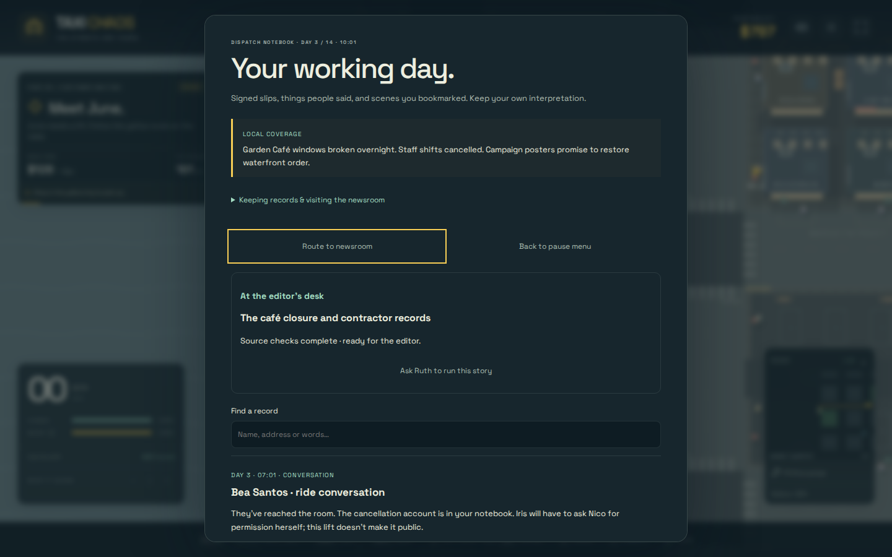
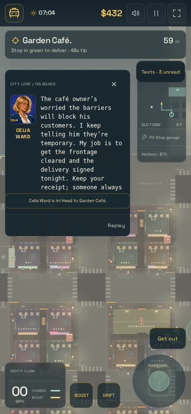

# Stateful scenario CLI

Run a sequence against **one real `Game`**, with the same map, mission director,
120 Hz simulation, campaign scheduler, records and save migrators as the app.
PNG checkpoints use the actual renderer, HUD, portraits, inbox and notebook in
one isolated Chromium context. No normal progress or preferences are written.

```sh
npm ci
npx playwright install chromium
npm run scenario:run -- --scenario docs/scenarios/open-shore.json
```

This reproduces the [Open Shore investigation](open-shore.md#manual-reproduction)
in 73 commands, with checkpoints for pickup, travel, arrival, safe sleep,
boarded café, Nico, receipt, source checks, editorial acceptance, publication and
contract suspension. It also round-trips Nico's accepted ride through a serialized
save and checks that the branch stays committed. It spends under 16 simulated
seconds on physics, using the chronological scheduler for longer calendar waits.

```sh
# Fast CI check: same commands and assertions, no browser or PNGs.
node tools/scenario-run.mjs --scenario docs/scenarios/open-shore.json --json

# Verify that unseen world events grant no evidence or articles.
npm run scenario:run -- --scenario docs/scenarios/missed-cafe.json

# Inject a hypothesis before the scheduled hearing and inspect the consequence.
npm run scenario:run -- --scenario docs/scenarios/tenant-hearing.json

# Discover valid IDs; no browser installation required.
npm run scenario:run -- --list

# Review compact touch layouts.
npm run scenario:run -- --scenario docs/scenarios/open-shore.json \
  --width 390 --height 844 --touch --output scenario-runs/cafe-mobile
```

Set `CHROMIUM_PATH` to reuse an installed browser. The CLI starts and closes its
own loopback Vite server and browser. It aborts external network requests and
fails on browser/console errors or storage writes. A `--output` directory must
be new; existing artifacts are never replaced. The default directory is
`scenario-runs/NAME-TIMESTAMP`, ignored by git. With `--json`, `--output` is
optional and saves the JSON manifest alongside clean JSON stdout.

## Scenario files

```json
{
  "version": 1,
  "name": "Contractor arrives",
  "options": { "traffic": "quiet", "noPolice": true },
  "steps": [
    { "op": "advance", "event": "ms14-arrives" },
    { "op": "expect", "path": "campaign.world.van", "equals": "at-cafe" },
    { "op": "place", "at": "garden-cafe" },
    { "op": "capture", "name": "contractor-arrived" }
  ]
}
```

Every command accepts an optional `label` for readable failure reports. Unknown
commands, fields and IDs fail clearly. Quiet mode removes ambient traffic,
parked cars and golf carts, while retaining the cab and campaign contractor van.
Use `"traffic": "normal", "noPolice": false` for normal city traffic/police.
The map, pedestrians, physical collisions, damage and campaign remain active.
No invincibility is applied.





| Command | Fields / example | Behavior |
| --- | --- | --- |
| `facts` | `"facts": {"flags":{"tenant-interview-reached":true},"choices":{"nico-trip":"room"},"cash":500,"health":65,"heat":1}` | Inject explicitly labelled hypotheses. Flags must be known; choices must be valid and cannot overwrite a committed choice. Flags accept `false` to clear them. Cash, health and heat are bounded. Validates all facts before mutation. |
| `advance` | `"minutes":180` **or** `"to":{"day":3,"hour":7,"minute":0}` **or** `"event":"tenancy-hearing"` | Move the campaign clock forward through the real chronological scheduler. Resolves all intervening world events, checks, editions, responses and pickup expirations. Runs no physics and grants no observations. Day defaults to 07:00. No backwards time or dates past the finale. |
| `place` | `"at":"garden-cafe"` or `"at":{"x":4,"y":32}`, optional `"angle":-1.5708` | Explicit fixture placement of the active actor, at rest. Accepts compiled stop IDs plus `pickup`, `dropoff`, `garage`, `newsroom`. Does not advance time or fabricate a pickup. |
| `step` | `"seconds":8.1,"keys":["KeyW","ShiftLeft"]` | Run real fixed 120 Hz updates. Keys last for this command and are cleared afterwards. Can test driving, collision, wait gates and pause behavior. Use `--list` for supported keys. |
| `mode` | `"mode":"paused"` | Use the game's mode transition. Supports `intro`, `playing`, `paused`, `garage`, `arrested`, `wasted`. |
| `route` | `"mission":"nico-safe-ride"` | Select an eligible physical text offer; routing does not commit its pickup choice. |
| `pickup` | No fields | Place at the currently routed pickup and run 0.9 seconds of real updates. Assert that the same job is accepted. Runs its choice and conversation hooks. Requires a playing driver. |
| `deliver` | No fields | Place at the aboard ride's destination and run 0.9 seconds of real updates. Assert one delivery, then retain real payment, material, dispatch and arrival dialogue effects. Requires a playing driver. |
| `read` | No fields | Reveal and retain the active dialogue through its real record handler. Does not invent an untriggered travel beat. |
| `ordinary` | No fields | Ask dispatch for an ordinary fare. Rejects an aboard ride; use `abandon` explicitly first. |
| `abandon` | No fields | Abandon the current ride through normal mission lifecycle handling and dispatch again. |
| `sleep` | No fields | Use actual safe Pit Stop sleep, including its mode, passenger, pursuit, damage and dialogue restrictions. Place at `garage` and set `paused` first. |
| `photo` | No fields | Bookmark the café through the real proximity, speed and frontage-state gates. |
| `submit` | `"material":"cafe-photo"` | Leave a possessed original's copy through the real newsroom proximity gate. |
| `publish` | `"allegation":"coordination"` | Ask the editor to run a verified case through the real editorial gate. Publication and response still wait for their boundaries. |
| `reload` | No fields | Serialize the current save, run story/record/campaign migrators and reconstruct a persistence-disabled `Game`. Accepted authored rides resume; transient physics resets just as after loading. No browser refresh or localStorage write. |
| `expect` | `"path":"campaign.world.security","equals":"suspended"` | Assert against a detached snapshot. Supports exactly one of `equals`, `includes`, `length`, `exists`, `gte`, `lte`. |
| `capture` | `"name":"ready-case","view":"notebook","panelOnly":true` | Capture a checkpoint. Views: `world` (default), `story`, `texts`, `notebook`, `pause`. Optional `focus` (`actor`, `cafe`, `newsroom`, `hotel`) and `zoom` (5–24) frame a world detail without moving the actor. PNG mode uses the actual UI. Headless mode retains the same marker/state without making an image. |

`route`, `photo`, `sleep`, `submit` and `publish` require success by default.
Add `"expected":false` to assert that an action is rejected. A typo in an ID
always fails, including when expecting rejection.

`pickup` and `deliver` are deliberately **fixture placement plus real gameplay
updates**, recorded that way in the report. They test the ride lifecycle without
waiting for an automatic driving controller. They do not prove that a route can
be driven without collisions. For that, use explicit `place` once for setup and
`step` commands with real driving keys. The supplied travel checkpoint waits
eight seconds, places the cab at the destination, then steps one frame to trigger
the real distance/time gate before delivery. This tests dialogue gating, while
remaining explicit about the injected movement.

Facts do not grant receipts, observations, verified cases or publications.
Those must go through actual interactions. Advancing to a named world event
resolves its authored time and **all** preceding events; it never invokes a later
operation early. A fact supplied after a resolved hearing cannot change its
outcome.

## Stateful JSON-lines input

Keep one CLI process open and send one JSON object per line. Each command replies
with one JSON line containing its index, status, result, detached state and any
shot metadata. This is suitable for another agent or a script that chooses its
next command from the last reply. Invoke `node` directly to avoid npm's banner.

```sh
node tools/scenario-run.mjs --stdin --output scenario-runs/live-session <<'JSONL'
{"op":"advance","event":"cafe-boarded"}
{"op":"expect","path":"campaign.world.cafe","equals":"boarded"}
{"op":"place","at":"garden-cafe"}
{"op":"photo"}
{"op":"capture","name":"frontage"}
JSONL
```

Add `--json` to run the same stateful stream without a browser. EOF ends the
session. The first failed command stops the stream and exits with status 1;
successful expected rejections continue. Streaming starts with the default quiet
city and no police; use a scenario file for different environment options.

## Assertions and artifacts

Paths address `Game.snapshot()` fields using dotted names and array indices,
for example `campaign.publications.0.allegation`. Convenient detached projections
also include `flags`, `choices`, `completed`, `failed`, `notebookIds`, `materialIds`,
`sleepReason` and `physicsSeconds`. Array `includes` uses deep equality; string
`includes` uses substring matching. `equals` compares complete JSON values without
depending on object-property order. A missing field differs from explicit `null`;
use `exists:false` to assert absence. Numeric comparisons require numeric fields.

The manifest contains initial/final state, every command and its resulting state,
injected facts and placements, selected environment, assertion diagnostics and PNG
metadata. PNG names have the command index and chosen stem. Panel captures record
bounds, scrolling and viewport overflow so compact-layout problems remain visible.
Capture views do not advance time, mark inbox messages read or pause the underlying scenario. Notebook
capture is an inspection view; `submit`/`publish` still require real proximity.

Runtime failure leaves a partial manifest and a final world PNG. Validation errors
before startup print a diagnostic and create no run. No screenshot file is created
in `--json` mode. All modes use a maximum of 500 commands, 30 simulated seconds
per `step`, and 120 total physics seconds per run. Browser commands have a
30-second wall-clock guard. Use `advance` for long campaign waits; split long
physical tests into separate scenario runs.

Implementation: `src/scenarios/runner.ts` is DOM-free and shared by Vitest, the
headless CLI and the opt-in `?scenario-preview=1` app hook. The browser hook freezes
normal animation updates and renders only at command/capture boundaries. It keeps
one game throughout the run; each PNG is a view of the state reached so far.

`npm test` covers the runner and supplied scenarios. After installing Chromium,
`npm run scenario:test` checks the real CLI subprocess: piped EOF handling,
headless/PNG state parity (including inbox inspection), failure reports/PNGs,
malformed input and refusal to overwrite an existing run.
