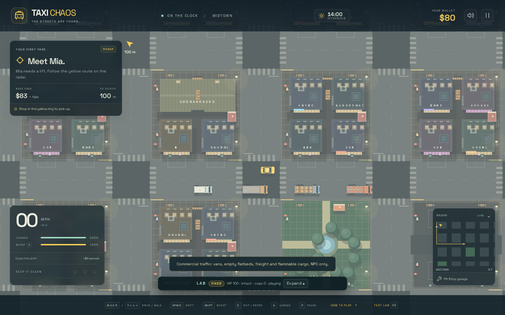
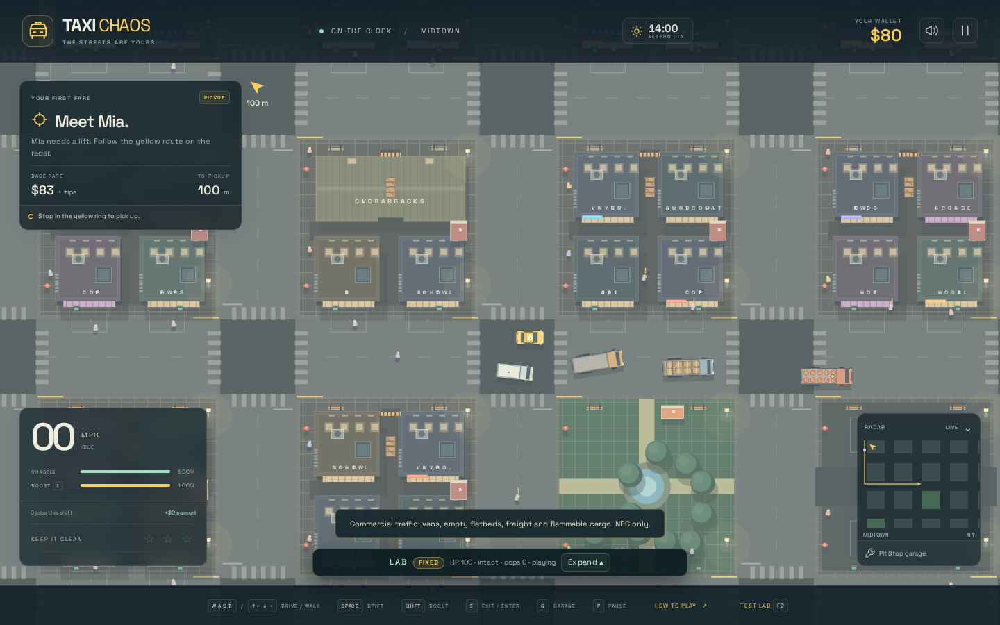
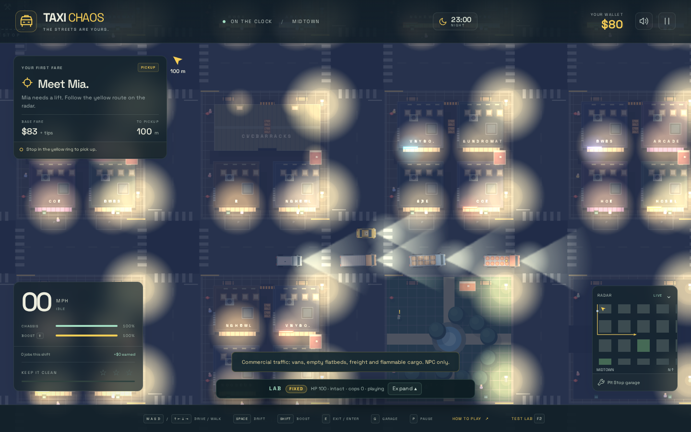
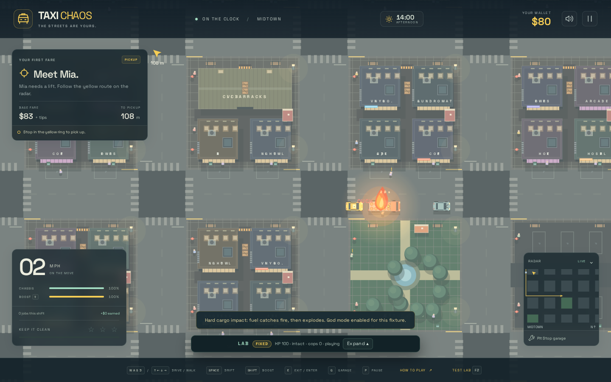
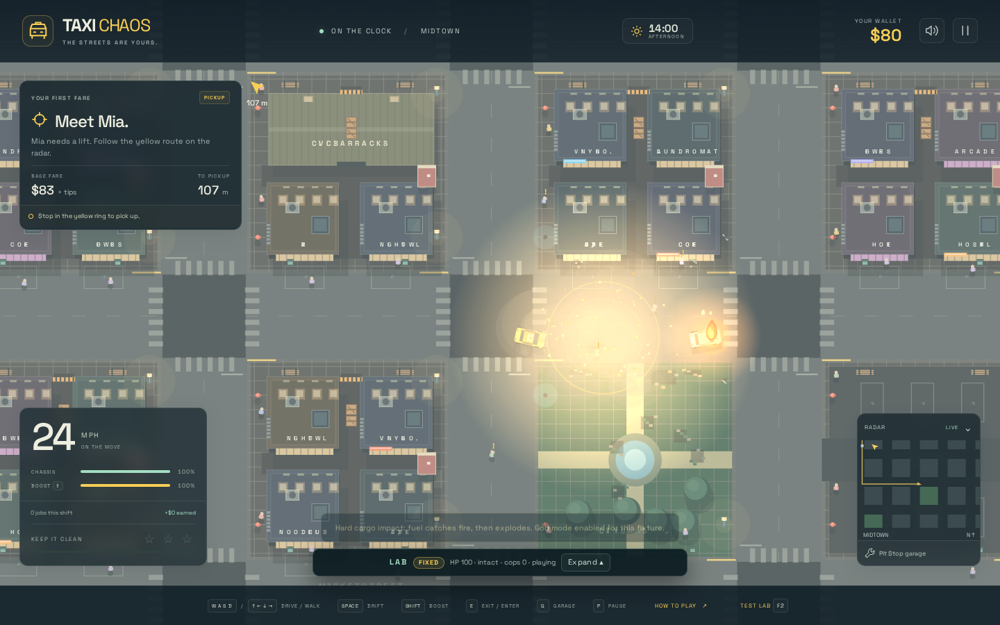

# Vehicle survey and extension API

Taxi Chaos has seven vehicle models. Models describe the body, graphics and handling;
roles (`taxi`, `police`, `traffic`) describe who controls them. The player, civilian cars
and police use the same car model with role-specific liveries and police difficulty tuning.

## Fleet survey

Dimensions are length × width in metres; mass includes the fixed payload. These are
gameplay tuning values, not a calibrated vehicle simulator.

| Model | Total mass | Dimensions | Tyres | Appearance / behavior | Player access |
| --- | ---: | --- | ---: | --- | --- |
| `car` | 1,000 kg | 4.2 × 2.1 | 4 | City car, taxi or police livery; tyre-force steering and handbrake drift | Cars/taxis available; police entry blocked by role |
| `motorcycle` | 260 kg | 2.6 × 0.8 | 2 | Inline wheels, force-derived rider lean, rear brake, parcel rack | Available; parcel jobs |
| `golf-cart` | 360 kg | 2.7 × 1.6 | 4 | Fairway patrol; crushable body and impact-driven overturn | NPC only |
| `van` | 2,100 kg | 5.6 × 2.2 | 4 | Tall delivery body, rear doors and roof lettering; slower pull/braking than cars | NPC only |
| `truck-empty` | 4,200 kg | 7.8 × 2.5 | 6 | Three-axle cab and visibly empty flatbed | NPC only |
| `truck-loaded` | 8,200 kg | 7.8 × 2.5 | 6 | Same chassis plus 4,000 kg of strapped crates; more inertia, lower cornering limit | NPC only |
| `truck-flammable` | 7,400 kg | 7.8 × 2.5 | 6 | Same chassis plus 3,200 kg of fuel barrels and hazard placard; cargo fires and larger blasts | NPC only |

Every road vehicle uses the same 120 Hz force/integration/SAT collision pipeline. All have
damage, fire, physical wrecks, pedestrian interactions, pool/ocean sinking and spatial audio.
Truck cargo stays tied to the chassis. Trucks use planar rigid-body yaw; the golf cart's
special overturn animation remains separate.

Normal traffic starts with 23 moving vehicles: 14 cars, 3 vans, 2 empty trucks, 2 freight
trucks and 2 fuel trucks. Parked cars/bikes and the three fairway carts remain separate.
The density control and off-screen replenishment use the same commercial model mix.
Spawn placement checks the actual body against scenery, pools, other vehicles and occupied
parking bays. Commercial vehicles are excluded from on-foot ride selection and blue radar
markers even if parked or abandoned; enabling access later is an explicit definition change.

## Measured handling differences

Isolated flat-road bodies, stock engines, full throttle without boost for three seconds;
braking measured from 12 m/s until forward speed falls below 0.5 m/s. No NPC speed governor.

| Model | Speed after 3 s | Braking distance | Yaw inertia, rounded |
| --- | ---: | ---: | ---: |
| Car | 20.02 m/s | 3.38 m | 1,838 kg·m² |
| Van | 15.10 m/s | 7.67 m | 6,335 kg·m² |
| Empty truck | 12.44 m/s | 9.35 m | 23,482 kg·m² |
| Freight truck | 7.17 m/s | 13.29 m | 45,845 kg·m² |
| Fuel truck | 7.85 m/s | 12.67 m | 41,372 kg·m² |

Mass is `chassis.mass + cargo.mass`; yaw inertia follows the existing rectangular-body
formula `mass × (length² + width²) / 12`. Impulses act through inverse mass/inertia, so an
off-centre hit turns a laden truck less than an empty one. Vehicle-to-vehicle damage splits
with relative mass; equal cars retain the previous damage scale. Blast impulses give heavy
vehicles less velocity instead of cancelling their mass. Payload variants share engine
force but tune grip, braking and lateral traction separately.

Commercial drivers have lower cruise speeds, larger following margins and advance corner
braking. Corridor sensing and reverse previews use their true footprint, tyre layout and
dynamics. Slow corner sensing keeps a stopping-distance sweep so a long truck can turn
without treating the opposite city block as an immediate dead end. The collision broad
phase uses body radii; two long trucks still collide when their centres are over 6 m apart.

Fuel cargo ignites after a damaging cargo-area impact with at least 14 m/s closing speed,
or a nearby blast delivering at least 24 raw damage. Scrapes and moderate cab-only impacts
do not ignite cargo. The normal readable fire/fuse lifecycle applies: cargo-impact fire
uses a 3.5-second fuse; chain blasts can shorten it. Repeated hits cannot postpone detonation.
A fuel truck produces one 24 m / 190-power blast (ordinary vehicles: 13 m / 110), which can
ignite neighbors. Sinking vehicles suppress fire and underwater blasts.

## Source API

[`src/vehicles.ts`](../src/vehicles.ts) is the catalogue and factory entry point. `VehicleModel`
is derived from its keys, so a new entry joins the type system automatically. A definition
contains:

| Section | Configurable properties | Consumers |
| --- | --- | --- |
| `chassis` | Dry mass, length, width | Body geometry, mass/inertia, spawn clearance, collision bounds, proportional commercial art and headlights |
| `physics` | Dynamics class, engine force, grip, tyre positions/steered axles, brakes, reverse ratio, drag, rolling/coast resistance, steering lock/speed falloff, lateral acceleration cap | Dynamics factory, live forces, AI stopping distance and physical reverse previews |
| `graphics` | Sprite family, default paint, trim/glass/roof/cargo colors, commercial cab length, engine sample pitch | Canvas body/cargo drawing and audio; role liveries retain their dedicated details |
| `cargo` | Cargo kind, fixed mass, flammability, impact/blast ignition thresholds, fire fuse | Body mass/inertia, flatbed contents and fire lifecycle |
| `damage` | Impact/blast damage multipliers, blast radius and power | Shared collision/damage/blast systems |
| `ai` | Road/golf controller, cruise speed, corner slowdown, following gap | NPC routing and sensing; golf retains its special patrol/crush behavior |
| `access` | Player availability and job type | Ride selection/radar, dispatch and upgrade baseline |

`physics` inherits `defaultCarTuning` for omitted car settings. Motorcycle dynamics retain
their dedicated lean/traction controller and inherit the configurable engine, geometry,
brakes, drag, steering lock and tyre layout. Factories copy every tyre, so changing steering
or damage on one vehicle cannot modify another vehicle's contacts.

Spawn with named options:

```ts
const truck = game.spawnVehicle({
  model: 'truck-loaded',
  kind: 'traffic',
  position: { x: 100, y: 83 },
  angle: 0,
  color: '#719dac', // optional per-instance paint override
});
truck.path = [{ x: 160, y: 83 }]; // or let the road driver plan automatically
```

The old positional `game.vehicle(kind, x, y, angle, color, model)` delegates to the same
factory for existing tests/fixtures. `createVehicleBody(definition, position, angle)` and
`createVehicleDynamics(definition)` support isolated physics testing and recovery previews.
`spawnVehicle` itself places exactly where asked; the traffic population methods do the
occupancy checks. Lab/manual spawns should choose an open road or validate the footprint.

To add a model, spread a suitable existing definition into `vehicleDefinitions`, then
override its name and desired sections. For example, a future heavier van only needs a
new catalogue entry with updated chassis/physics/colors. Add its ID to `roadTrafficModels`
to include it in normal traffic. The existing `car`, `motorcycle`, `golf-cart`, `van` and
`truck` sprite families are reusable; a wholly new silhouette requires a renderer function
and a new sprite discriminator. Model and definition identity are readonly on each Vehicle:
spawn a replacement when changing models so body, tyres and graphics remain consistent.
Source tuning changes apply to newly created vehicles; reset the run after editing the catalogue.

New commercial definitions currently set `access.playerDrivable: false`. A later unlock
system can build on that access policy and `access.job`, without duplicating the spawning,
physics, damage or graphical setup. Upgrades use the selected definition's engine/grip
baseline, rather than a car-versus-bike switch.

## Lab API and visual fixtures

F2 → **Vans / freight traffic** (`commercial-traffic`) stages the four moving NPC models.
F2 → **Flammable cargo / impact** (`flammable-cargo`) physically rams a fuel truck's rear
with a god-mode cab; a nearby vulnerable car demonstrates the blast chain. Both disable
police for inspection; normal gameplay has neither cheat enabled.

```js
__taxi.vehicleModels(); // catalogue plus IDs; returns detached copies
const id = __taxi.spawnVehicle({
  model: 'van', position: { x: 80, y: 83 }, angle: 0,
});
__taxi.vehicles().find(v => v.id === id);
// model, mass, inertia, dimensions, cargo, playerDrivable, damage, AI and pose
__taxi.scenario('flammable-cargo');
__taxi.step(1.2); // truck is burning from the collision, before detonation
```

## Production screenshots

Captured from the built standalone HTML at 1440 × 900 with networking offline.











Verification: full test suite and production build; stock acceleration/braking comparisons;
all commercial models negotiating city corners, bridge crossings and highland bends at
100 HP; offline browser fixture/API checks, screenshots, chain ignition, NPC-only access
and a 390 × 844 overflow check. Browser inspection reported no runtime errors or external
network requests.
