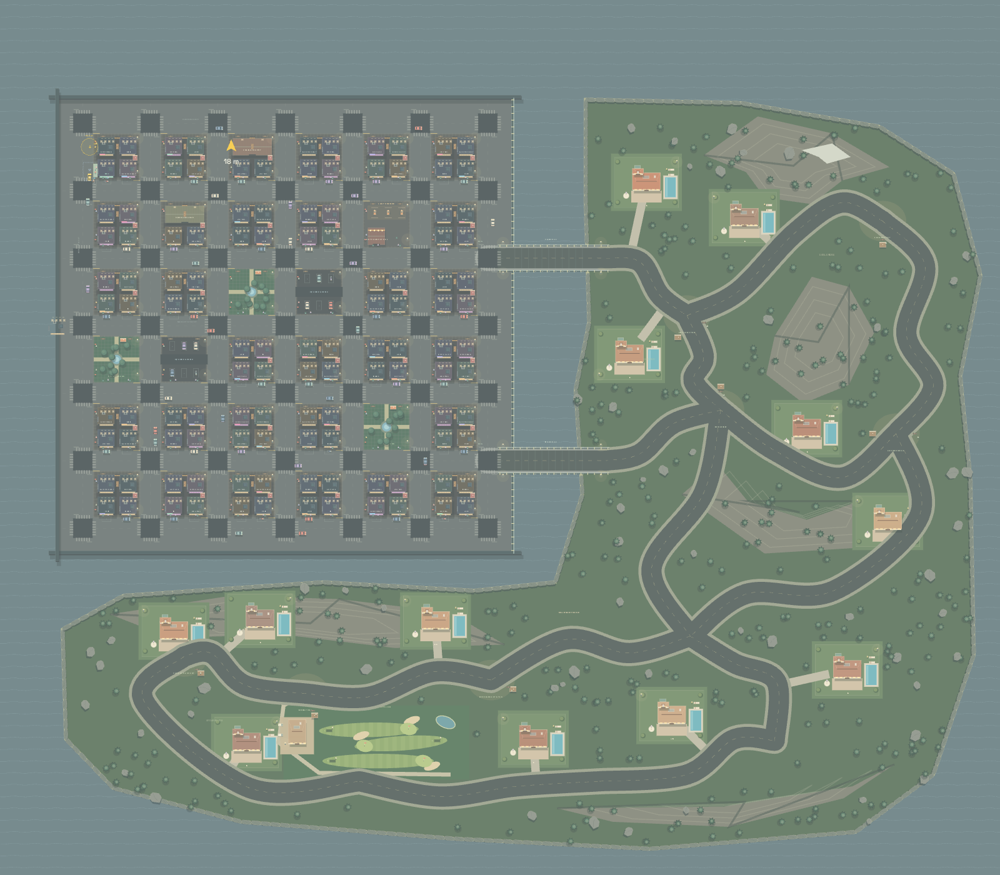
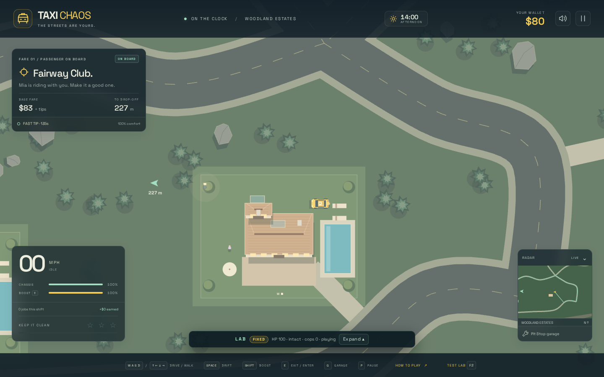
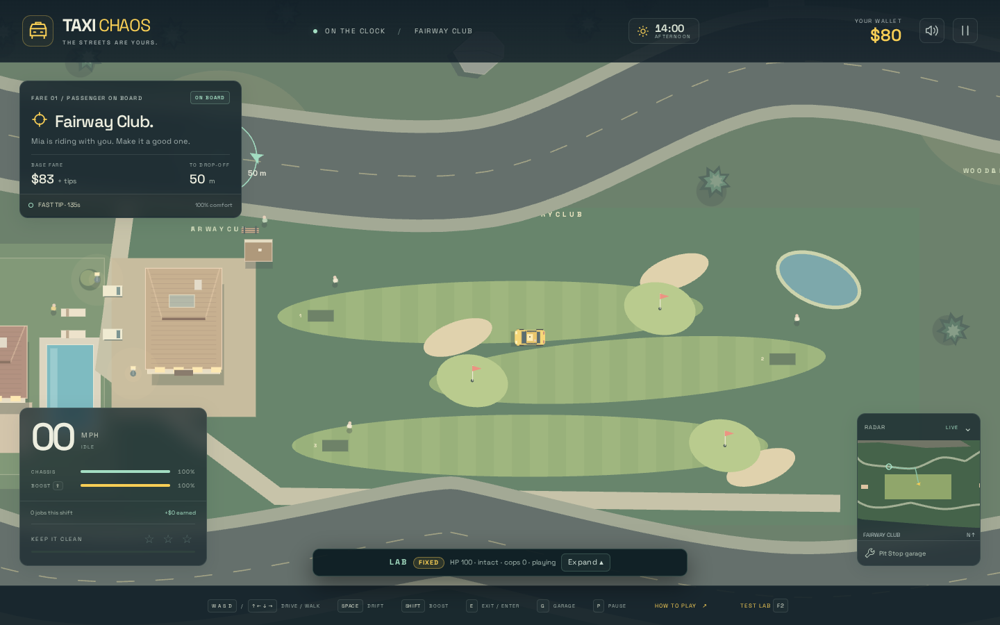
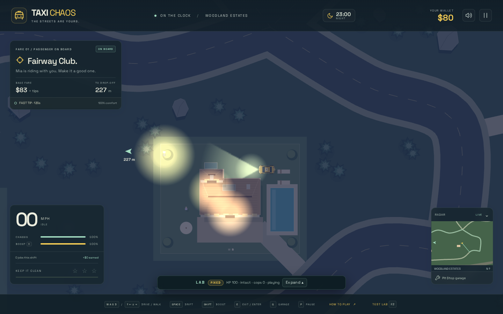

# Woodland estates and Fairway Country Club

The woods continue down the eastern side and wrap west below the city grid in a
mirrored L. The southern inlet separates the new forest from the city waterfront;
Pine Bridge and Fern Bridge remain the entrances from town. The winding southern
road loop connects to Poble-sec and Parc del Mirador.

The overview uses the game renderer at reduced zoom (1600 × 1400). The gameplay
screenshots below were taken from the standalone production HTML at 1440 × 900,
with the simulation clock fixed for reproducible captures.

## Millionaires in the woods

Seven estates remain in the southern forest, beyond the residential Poble-sec neighbourhood.
Each has a solid villa and guest wing, a drivable access lane, a landscaped lawn,
a pool, loungers, a stone terrace and two residents. Private roads and public roads
remain clear of trees, rocks and structures. Estate lights use the existing nighttime
lighting and occlusion system.

## Fairway Country Club

Three fairways have mowing stripes, tee boxes, putting greens, flags and bunkers.
The club includes a clubhouse, walking golfers, a pond, cart path and decorative
parked carts. The public dropoff is on Fairway Drive, rather than inside the clubhouse.

## After dark

Warm villa windows and garden lamps illuminate the estates while the wooded lanes
use the existing headlight system.

## Explore and validate

F2 → **Woodland villas / golf club** → **Run** starts at (242, 330) with a passenger
bound for Fairway Club at (132, 338), with police disabled for the scenic fixture.
Use `__taxi.scenario('woodland-estates')` for automation.

Woodland Estates, Fairway Club and Cedar Crescent join the normal taxi/parcel stop
list. Road projections, routes, traffic recovery, police goals/spawns and fare/time
calculations recognize countryside below the grid as well as east of it.

Validation: `npm test` passes all 244 tests; `npm run build` passes strict TypeScript
checking and creates the standalone HTML. Regression coverage includes the mirrored
L footprint and inlet, both lanes of every new road, all twelve villa driveways,
clear gardens/fairways, city-to-south routes in both directions, civilian driving
around the extension, and a paid southern delivery. A browser check completed the
Fairway Club delivery offline at 100% health with no contacts, no external runtime
requests and no page errors.
